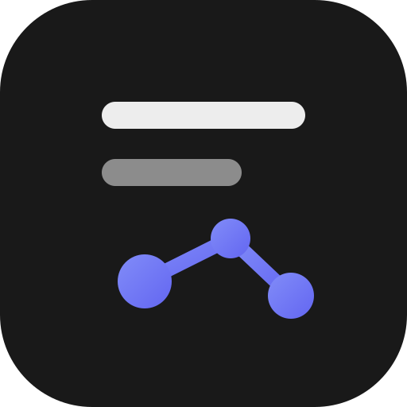
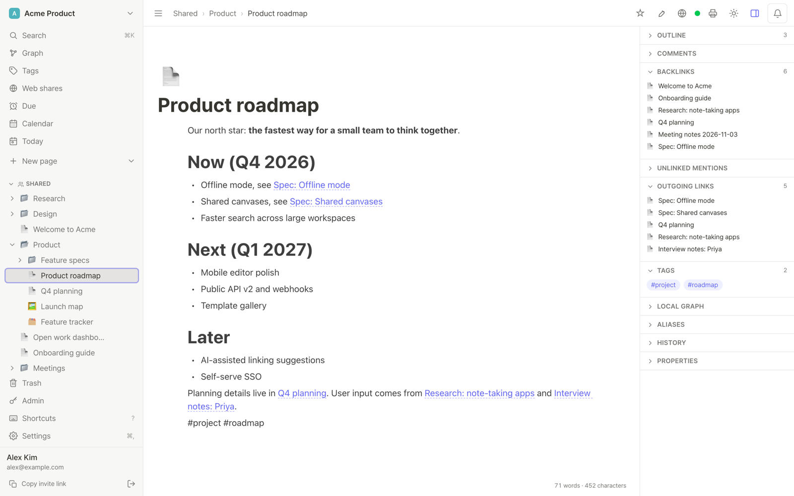
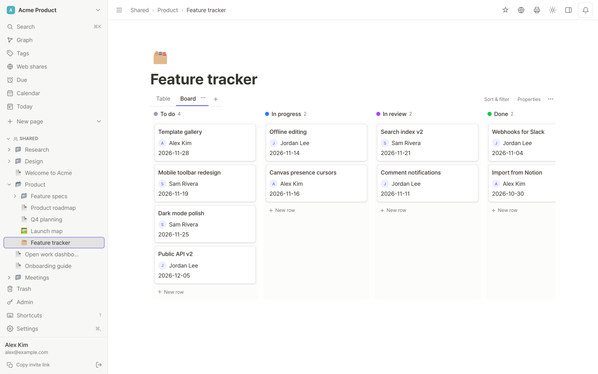
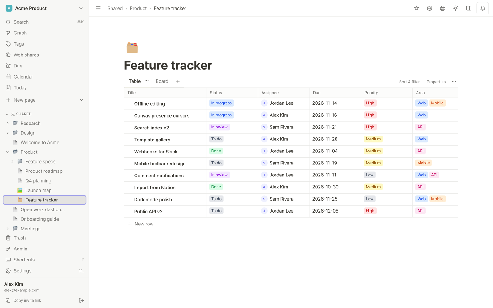
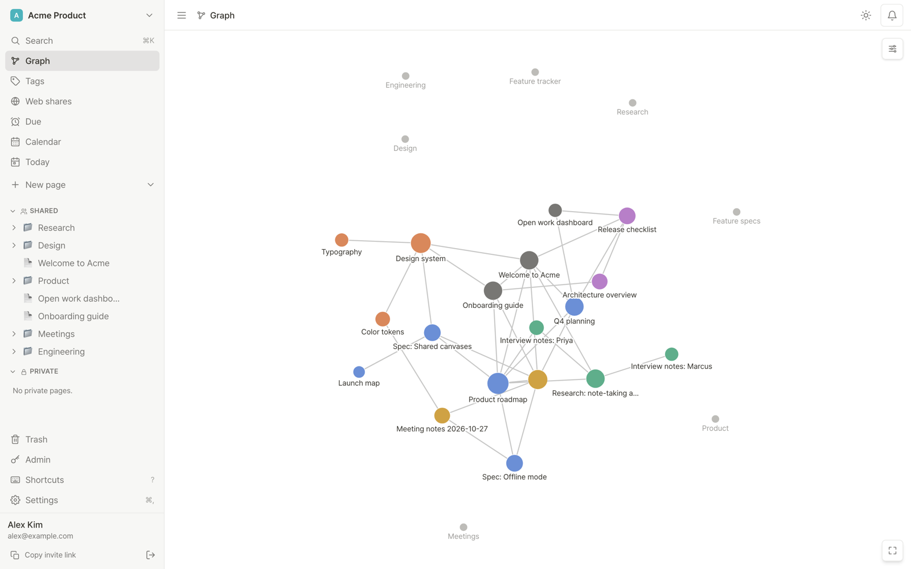
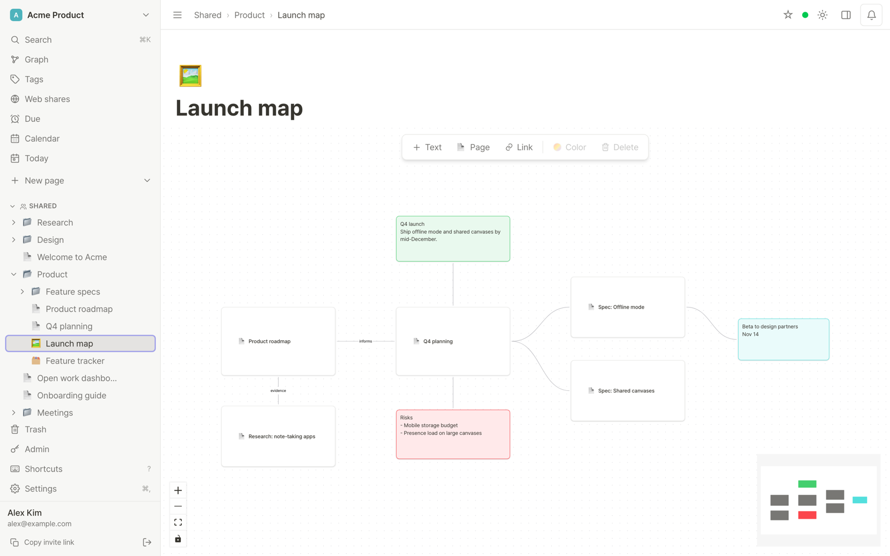
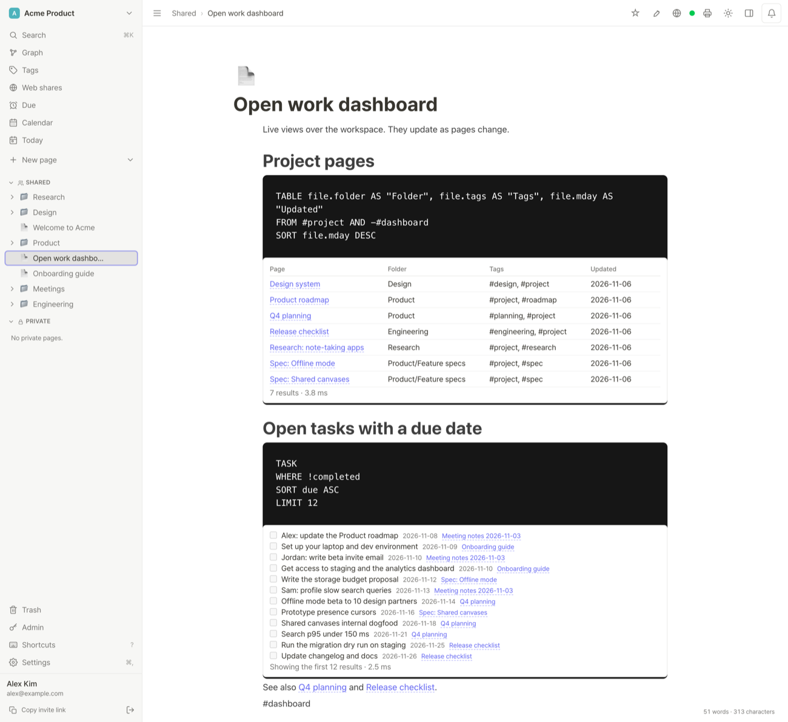
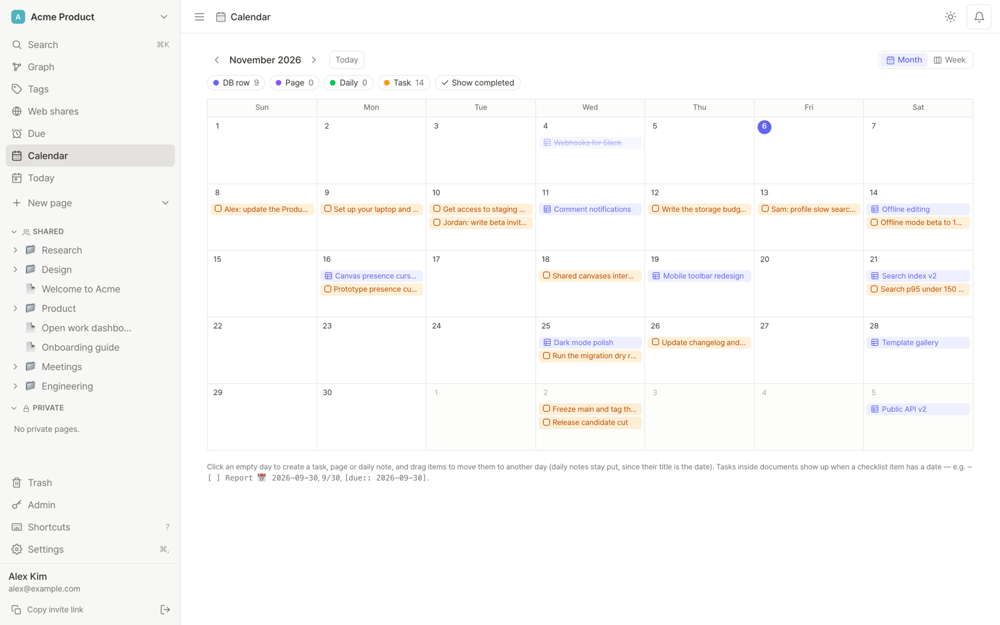

<p align="center">
  
</p>

<h1 align="center">Inkling</h1>

<p align="center">
  노션식 데이터베이스와 옵시디언식 링크·그래프·JSON Canvas를 한 앱에 담은 셀프호스트 노트입니다.
  실시간 동시 편집과 AI 에이전트용 MCP 서버가 기본으로 들어 있습니다. MIT 라이선스이고 모든 기능이 무료입니다.
</p>

<p align="center">
  <a href="LICENSE"></a>
  <a href="https://github.com/PROVE1352/inkling/actions/workflows/ci.yml"></a>
</p>

<p align="center">
  <a href="README.md">English</a> · 한국어
</p>



| | |
|---|---|
|  |  |
|  |  |
|  |  |

스크린샷은 영어 UI입니다. 설정 › 언어에서 한국어로 바꿀 수 있습니다.

## 기능

**쓰기**
- BlockNote 블록 에디터: 슬래시 메뉴, 표, 하이라이트되는 코드 블록, 체크리스트, 콜아웃, 이미지와 파일 끌어다 놓기
- 자동완성되는 `[[위키링크]]`, `#태그`, `@멘션`, 데일리 노트
- 페이지 하나나 구조 전체(하위 페이지, 보기까지 갖춘 데이터베이스, 캔버스)를 담는 템플릿: 변수와 입력 질문, 옵시디언 Templater 기본 문법, 검색되는 갤러리, .md/.zip 가져오기·내보내기 ([docs/TEMPLATES.md](docs/TEMPLATES.md))
- 이름 붙인 스냅숏이 있는 버전 기록, 댓글, 복원 가능한 휴지통, PDF 내보내기(인쇄 CSS)
- 한국어·영어 UI, PWA 설치, 라이트·다크 테마

**정리와 데이터베이스**
- 중첩 페이지와 폴더, 워크스페이스마다 공유 페이지와 나만 보는 개인(🔒) 페이지, 끌어서 순서 바꾸기
- 표·보드·캘린더·갤러리·타임라인 뷰가 있는 데이터베이스. 속성은 텍스트, 숫자, 선택, 다중 선택, 날짜, 체크박스, 사람, URL, 관계, 롤업. 정렬·필터·그룹
- 워크스페이스 전체의 마감일과 할 일(마감 뷰, 전체 캘린더), 제목과 본문을 함께 찾는 ⌘K 검색

**연결**
- 오른쪽 패널의 백링크, 링크 안 된 언급, 나가는 링크
- 워크스페이스 그래프와 로컬 그래프
- 옵시디언 [JSON Canvas](https://jsoncanvas.org)(`.canvas`)와 호환되는 무한 캔버스
- 쿼리 블록: Dataview 문법의 일부(`TABLE` / `LIST` / `TASK`, `FROM`, `WHERE`, `SORT`, `LIMIT`)로, 페이지가 바뀌면 결과도 따라 바뀝니다([docs/QUERY.md](docs/QUERY.md))

**협업**
- Yjs 기반 실시간 동시 편집: 다른 사람 커서와 접속 표시, 오프라인에서 고친 내용은 다시 연결될 때 합쳐짐
- 초대 링크로 들어오는 워크스페이스, 페이지나 폴더 하위 트리를 읽기 전용으로 여는 공개 공유 링크
- 워크스페이스 소유권 넘기기, 소유자가 30일 안에 되돌릴 수 있는 워크스페이스 삭제
- 멘션·댓글·마감일 알림

**AI와 연동**
- OAuth 2.1 + PKCE를 쓰는 내장 MCP 서버. Claude Code, claude.ai 같은 MCP 클라이언트를 사용자별로 연결하고, 그 사용자가 볼 수 있는 페이지만 보입니다([docs/MCP.md](docs/MCP.md))
- 링크 미리보기와 임베드(YouTube, Vimeo, Loom, Figma, Spotify, CodePen, Google Docs). 외부 요청은 SSRF 필터를 거칩니다
- 멘션·댓글·마감일·새 페이지를 Slack·Discord 웹훅으로 알림
- 마감일 iCal 구독, 데이터베이스 CSV/XLSX 가져오기·내보내기, Google Sheets 읽기 전용 동기화(실험적)
- 마크다운·zip 가져오기·내보내기(front matter, 첨부 파일, `[[링크]]` 연결), 노션으로 올리기

**셀프호스팅과 운영**
- `docker compose` 하나로 Postgres, 앱, 백업 사이드카가 뜨고, Caddy 오버레이를 더하면 HTTPS가 자동으로 붙습니다
- 예약 백업: 검증, 선택적 암호화, GFS 보관, 주간 복원 테스트, rclone 외부 사본([docs/BACKUP.md](docs/BACKUP.md))
- 관리자 페이지: 사용자, 가입 키, 비밀번호 재설정 요청, 무차별 대입 방어로 걸린 IP 차단, 백업
- 선택 사항: 초대·비밀번호 재설정·이메일 인증용 SMTP, 외부 인증 서버로 로그인을 넘기는 위임 로그인

**실험적 기능**(`EXPERIMENTAL_FEATURES`에 적어야 켜짐)
- `inklingctl` CLI로 옵시디언 볼트와 양방향 동기화([docs/VAULT-SYNC.md](docs/VAULT-SYNC.md))
- 플러그인 API v0: 샌드박스 iframe에서 돌고 관리자가 승인해야 설치됨([docs/PLUGINS.md](docs/PLUGINS.md))
- Google Sheets 동기화: 시트를 그대로 비추는 읽기 전용 데이터베이스

## 빠른 시작

Docker와 Compose 플러그인이 필요합니다. HTTPS로 열려면 서버를 가리키는 도메인과 열린 80·443 포트가 있어야 합니다.

```bash
git clone https://github.com/PROVE1352/inkling.git
cd inkling
cp .env.example .env
# .env 수정: PUBLIC_URL=https://notes.example.com, DOMAIN=notes.example.com,
#           POSTGRES_PASSWORD=<긴 무작위 문자열>, BACKUP_PASSPHRASE=<서버 밖에도 따로 보관>

docker compose -f compose.yaml -f deploy/compose.caddy.yaml up -d --build
```

인증서는 Caddy가 받아 오고 갱신합니다. 이어서 첫 계정용 가입 키를 만듭니다. 처음 가입한 계정이 사이트 관리자가 됩니다.

```bash
./deploy/signup-key.sh new "first admin"
#   Signup key : ABCD-EFGH-JKMN-PQRS
#   Signup link: https://notes.example.com/register
```

가입 링크를 열고 키를 붙여 넣으면 끝입니다. 다음 키부터는 **관리자** 페이지에서 만들 수 있습니다.

도메인 없이 내 컴퓨터에서 먼저 써 보려면 `docker compose up -d --build` 후 http://localhost:3000 을 엽니다.
프로덕션 모드라 이때도 가입 키가 필요하니 위의 `signup-key.sh` 명령을 똑같이 실행하세요.

Compose 프로젝트, 볼륨, DB 역할 이름은 예전 이름인 `nodian`을 씁니다. 바꾸면 업그레이드 후 기존 데이터 볼륨을 찾지 못하니 그대로 두세요.

### 설정

꼭 볼 항목입니다. 모두 `.env`에 씁니다.

| 변수 | 기본값 | 설명 |
|---|---|---|
| `PUBLIC_URL` | 비어 있음 | 공개 주소. 예: `https://notes.example.com`. 메일 링크, OAuth 발급자, 공유 미리보기에 쓰이고 `Host` 헤더는 믿지 않습니다. `https://`로 시작하면 Secure 쿠키도 켜집니다. |
| `POSTGRES_PASSWORD` | `nodian` | DB 비밀번호. **처음 띄우기 전에** 바꾸세요. Postgres는 데이터 볼륨을 만들 때만 이 값을 읽습니다. |
| `SIGNUP_REQUIRE_KEY` | 프로덕션에서 필수 | 비워 두면 가입에 키가 필요합니다. `0`이면 누구나 가입할 수 있습니다. |
| `DEFAULT_LOCALE` | `en` | `en` 또는 `ko`. 언어를 고르지 않은 사용자에게 가는 메일과 기본 템플릿의 언어, 브라우저 언어보다 먼저 쓰는 UI 기본값입니다. |
| `TZ` | `UTC` | 마감일, 데일리 노트, 알림, 백업 일정의 "오늘"을 정하는 시간대. 예: `Asia/Seoul` |
| `COOKIE_SECURE` | 자동 | `PUBLIC_URL`이 `https://`면 저절로 켜집니다(Caddy 오버레이도 켭니다). `PUBLIC_URL` 없이 다른 방식으로 HTTPS를 쓸 때만 `1`로 두세요. |

나머지(백업, 로그인 실패 제한, 위임 로그인, 임베드, 실험적 기능, 메모리 한도, Postgres 튜닝)는
[.env.example](.env.example)과 [docs/OPERATIONS.md](docs/OPERATIONS.md)에 있습니다. 직접 운영하는 리버스 프록시 뒤에 두는 방법 등 배포 세부 사항은
[deploy/DEPLOY.md](deploy/DEPLOY.md)를 보세요.

<details>
<summary>Gmail로 메일 보내기(선택)</summary>

`SMTP_HOST`와 `MAIL_FROM`을 둘 다 넣어야 메일이 켜집니다. 2단계 인증을 켠 Google 계정에서 앱 비밀번호(Google 계정 › 보안 › 앱 비밀번호)를 만들어 `.env`에 넣습니다.

```dotenv
SMTP_HOST=smtp.gmail.com
SMTP_PORT=587
SMTP_SECURE=0
SMTP_USER=<Gmail 주소>
SMTP_PASS=<16자리 앱 비밀번호>
MAIL_FROM="Inkling <Gmail 주소>"
# 선택: 이메일 인증 전에는 로그인 막기(이 설정을 켠 뒤 가입한 계정에만 적용)
REQUIRE_EMAIL_VERIFICATION=0
```

그다음 `docker compose -f compose.yaml -f deploy/compose.caddy.yaml up -d app`. Gmail은 보낸 사람을 로그인한 계정으로 바꾸고 하루 발송량에도 제한이 있습니다. 팀이 크면 트랜잭션 메일 서비스를 쓰세요.

</details>

### 개발

Node 22 이상, pnpm(버전은 `package.json`에 고정), Docker가 필요합니다.

```bash
pnpm install
pnpm db:up      # Postgres, localhost:55432
pnpm dev        # API·협업 서버 :3001, 웹 :5173
```

테스트, CI, 작업 규칙은 [CONTRIBUTING.md](CONTRIBUTING.md)에 있습니다.

## 다른 도구와 비교

2026년 11월 기준으로 각 프로젝트의 저장소, 문서, 가격 페이지를 보고 정리했습니다. "EE"는 유료 엔터프라이즈 판에만 있는 기능입니다. 틀린 곳이 있으면 알려 주세요.

| | Inkling | [salt.md](https://github.com/saltmd/salt.md) | [Docmost](https://github.com/docmost/docmost) | [AFFiNE](https://github.com/toeverything/AFFiNE) | [Outline](https://github.com/outline/outline) |
|---|---|---|---|---|---|
| 라이선스 | MIT | AGPL-3.0 | 코어 AGPL-3.0 + 유료 EE | MIT. 서버 코드는 EE 라이선스지만 무료 셀프호스트 Community Edition은 예외 | BSL 1.1(2030-10-23에 Apache 2.0으로 전환) |
| 데이터베이스 뷰 | 표, 보드, 캘린더, 갤러리, 타임라인 | 표, 보드, 리스트, 갤러리, 캘린더, 타임라인, 폼 | EE | 표, 칸반, 캘린더 | 없음 |
| `[[위키링크]]` / 백링크 | 있음 / 있음 | `[[`로 링크 메뉴 열기 / 있음 | 없음(`@` 멘션) / 있음 | 있음 / 있음 | 있음 / 있음 |
| 그래프 뷰 | 있음 | 있음 | 확인 못 함 | 확인 못 함 | 확인 못 함 |
| 캔버스 | JSON Canvas(`.canvas`) | 없음 | Excalidraw, draw.io 임베드 | 자체 화이트보드(Edgeless), JSON Canvas 아님 | 없음(diagrams.net 임베드) |
| 실시간 협업 | 있음 | 있음 | 있음 | 있음 | 있음 |
| MCP 서버 | 내장, 무료 | 내장, 무료 | EE | 내장, AI 제공자 설정 필요, 기본은 읽기 전용 | 내장(요금제 제한: ?) |
| 옵시디언 볼트 동기화 | 양방향(실험적) | 없음 | 없음 | 단방향 가져오기 | 없음 |
| 노션 가져오기 | 없음(마크다운·zip 가져오기, 노션으로 올리기) | 있음 | 있음 | 있음 | 있음 |
| 셀프호스트 무게 | 앱 + PostgreSQL | Go 바이너리 하나 + SQLite | 앱 + PostgreSQL + Redis | 앱 + PostgreSQL(pgvector) + Redis | 앱 + PostgreSQL + Redis, 로그인용 SSO나 SMTP 별도 필요 |

Inkling이 약한 점도 있습니다. PostgreSQL이 꼭 필요하고(SQLite 모드 없음), 데스크톱·모바일 네이티브 앱이 없으며(웹 앱을 PWA로 설치), 인스턴스 하나로만 돌아가고(수평 확장 없음), 아직 사용자가 적은 새 프로젝트입니다.

## 구조

- **서버**(`apps/server`): Node 22, Fastify 5(`/api` REST), `/collab`의 Hocuspocus/Yjs 웹소켓 협업, PostgreSQL 16 위의 Drizzle ORM(트라이그램 검색, 부팅할 때 마이그레이션 적용), OAuth 서버가 딸린 `/mcp` 엔드포인트
- **웹**(`apps/web`): React 19, Vite, Tailwind CSS v4, BlockNote(ProseMirror) 에디터, React Flow 캔버스, d3-force 그래프, PWA
- **CLI**(`apps/cli`): 볼트 동기화용 `inklingctl`
- **공용**(`packages/shared`): 서버와 웹이 같이 쓰는 zod 스키마와 DTO, 쿼리 언어 파서
- **배포**(`deploy/`): Caddy 오버레이, 백업 사이드카 스크립트, 복원·관리 보조 스크립트

설계 설명은 [docs/ARCHITECTURE.md](docs/ARCHITECTURE.md), 결정과 그 이유는 [docs/adr/](docs/adr/README.md)의 ADR, REST 계약은 [docs/API.md](docs/API.md)에 있습니다. 문서는 영어입니다.

## 보안

Inkling은 서로 믿는 사람들이 워크스페이스 단위로 함께 쓰는 셀프호스트 단일 인스턴스를 전제로 만들었습니다. 인터넷에 열기 전에 다음을 확인하세요.

- **HTTPS 뒤에서 돌리세요.** `deploy/compose.caddy.yaml`을 쓰면 앱과 DB 포트도 밖에서 안 보입니다. 직접 운영하는 프록시에서 TLS를 끝내도 됩니다.
- **`PUBLIC_URL`을 설정하세요**(메일 링크를 다른 주소로 보내려면 `APP_URL`도). 비밀번호 재설정·인증 메일 링크, OAuth 메타데이터, 공유 미리보기가 이 값으로 만들어지고, `https://`면 세션 쿠키에 Secure가 자동으로 붙습니다.
- **가입 키 요구를 끄지 마세요**(프로덕션 기본값). 첫 관리자 키는 `./deploy/signup-key.sh`로 만듭니다.
- **`POSTGRES_PASSWORD`를 바꾸고** `BACKUP_PASSPHRASE`를 정해 서버 밖에도 보관하세요.
- `TRUST_PROXY`는 실제로 앞에 둔 리버스 프록시만 가리키게 하세요.
- 실험적 기능(`plugins`, `vault-sync`, `sheets-sync`)은 기본으로 꺼져 있습니다. 플러그인은 샌드박스에서 돌지만 관리자가 승인하면 신뢰하는 코드로 취급됩니다.

워크스페이스 멤버는 그 워크스페이스의 공유 페이지를 모두 읽고 고칠 수 있고, 개인 페이지는 만든 사람만 봅니다. 취약점 제보 방법은 [SECURITY.md](SECURITY.md)를 보세요.

## 알려진 문제

첫 공개를 막을 정도는 아니어서 남겨 둔 문제를 영역과 심각도별로 정리했습니다: [docs/KNOWN-ISSUES.md](docs/KNOWN-ISSUES.md). 앞으로 할 일은 [docs/ROADMAP.md](docs/ROADMAP.md)에 있습니다.

## AI 도움을 받아 만들었습니다

Inkling은 설계와 구현에 AI 코딩 에이전트를 많이 썼습니다. 그 뒤 생성된 코드가 잘 틀리는 곳을 겨냥해 여러 차례 검토했습니다. 동시성(경쟁 상태, 갱신 유실, 잠금), 자원(메모리, 연결, 끝없이 커지는 것), 보안을 코드 리뷰로 따로따로 살폈고, 성능은 추측 대신 측정을 근거로 손봤습니다. 그 과정에서 나온 결정과 절충은 [docs/adr/](docs/adr/README.md)에, 아직 못 고친 문제는 [docs/KNOWN-ISSUES.md](docs/KNOWN-ISSUES.md)에 공개해 두었습니다. 중요한 데이터를 맡기기 전에는 다른 새 프로젝트와 똑같이 꼼꼼히 살펴보세요.

## 기여

이슈와 풀 리퀘스트를 환영합니다. 먼저 [CONTRIBUTING.md](CONTRIBUTING.md)를 읽어 주세요. 큰 변경은 이슈에서 짧게 이야기한 뒤에 진행하면 받아들이기 쉽습니다.

## 라이선스

[MIT](LICENSE). 이 저장소의 기능은 모두 무료이고 유료 판은 없습니다.
