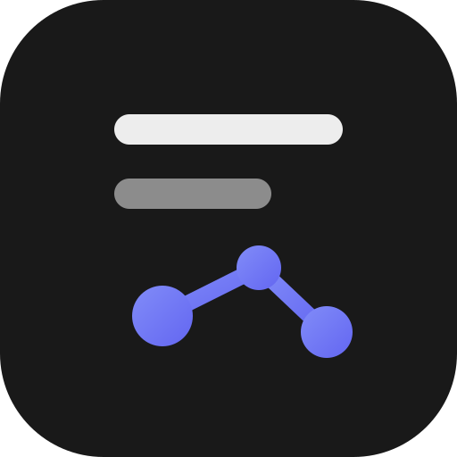
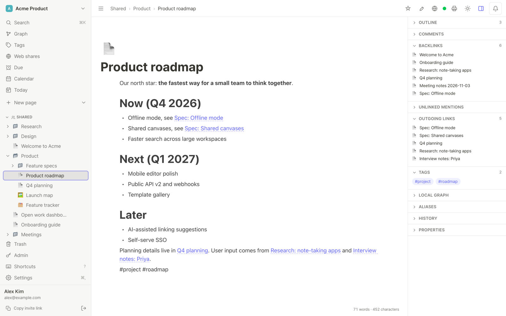
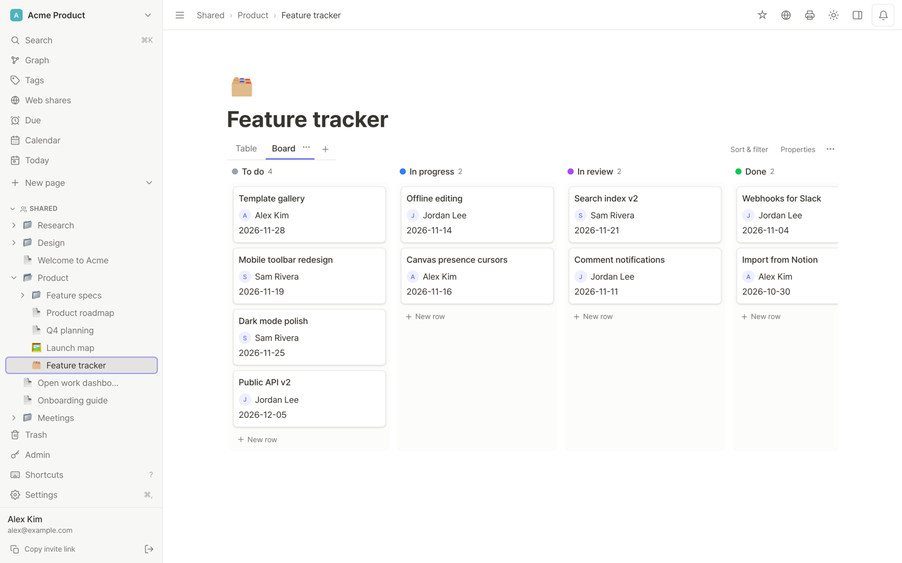
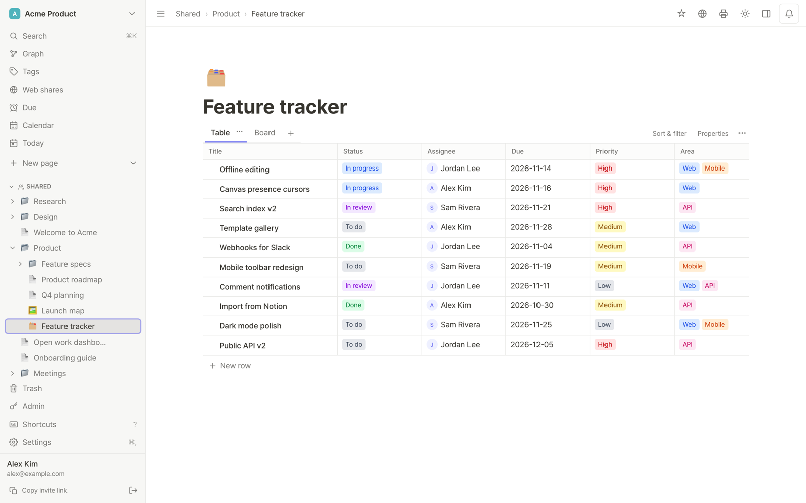
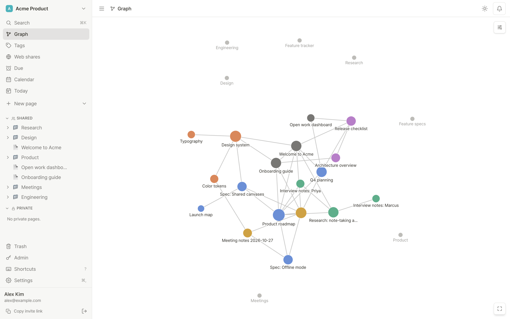
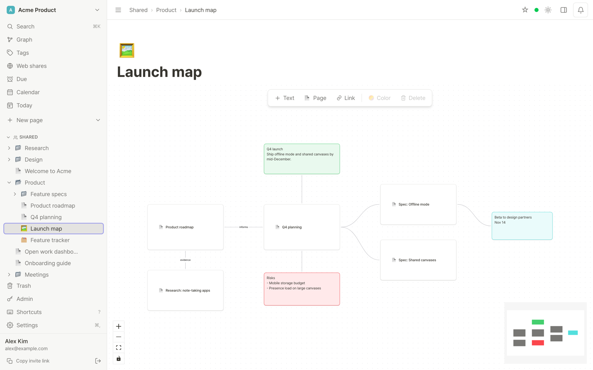
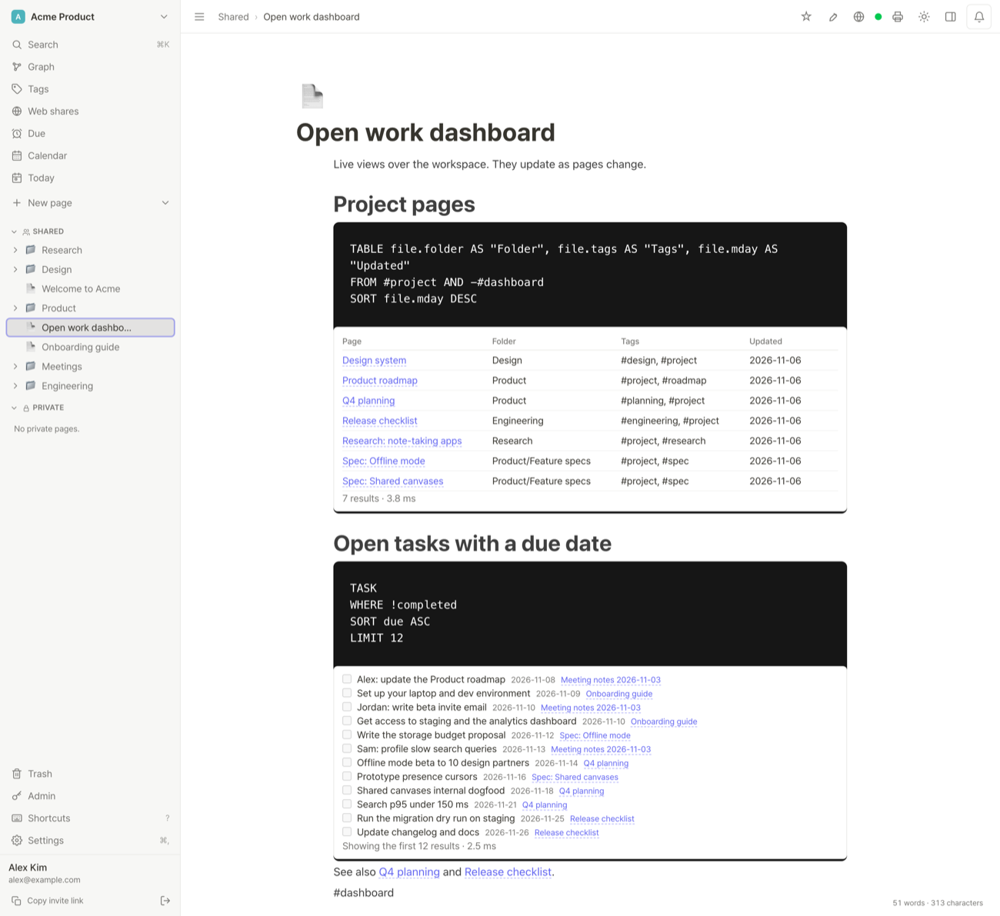
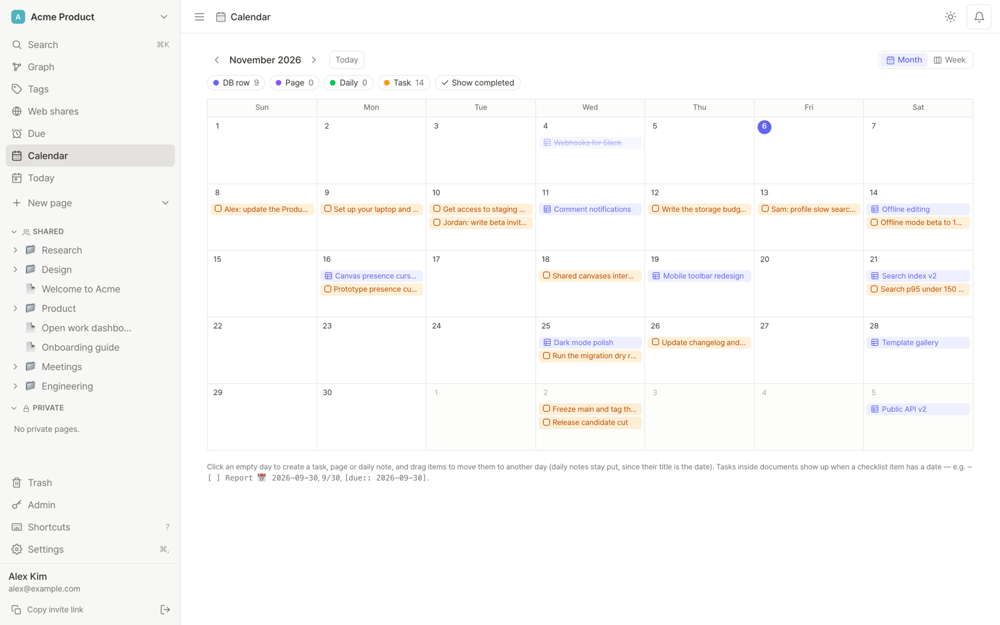

<p align="center">
  
</p>

<h1 align="center">Inkling</h1>

<p align="center">
  A self-hosted notes app that people and their AI agents read and write together: Notion-style
  databases, Obsidian-style links, graph and canvas, real-time editing and a built-in MCP server.
  MIT, every feature free.
</p>

<p align="center">
  <a href="LICENSE"></a>
  <a href="https://github.com/PROVE1352/inkling/actions/workflows/ci.yml"></a>
</p>

<p align="center">
  English · <a href="README.ko.md">한국어</a>
</p>

Inkling is for small teams, around three to five people who each work with their own AI agent, and for
one person who wants their notes on their own server. What sets it apart from other note apps:

1. **Agents read little and write carefully:** they read single sections within a token budget and edit one section against the version they read; their edits can be held as suggestions for people to accept, even in part, or reverted afterwards.
2. **Work can go to an agent:** a comment or a person cell can hand a task to one member's agent, which finds it in its inbox, and a Team agents board shows what every agent is on.
3. **Notion-style databases and Obsidian-style notes in one app:** table, board, calendar, timeline, chart and form views with formulas, next to `[[wikilinks]]`, backlinks, a graph and JSON Canvas.

Using a server someone else runs? Start with the [user guide](docs/GUIDE.md) ([한국어](docs/GUIDE.ko.md)).
A 40-second tour: [site/assets/promo.mp4](site/assets/promo.mp4).



| | |
|---|---|
|  |  |
|  |  |
|  |  |

## Quick start

You need Docker with the Compose plugin. To try it on your own computer:

```bash
git clone https://github.com/PROVE1352/inkling.git && cd inkling
./deploy/local.sh
```

The script writes a `.env` with generated secrets, starts Inkling on a free local port (usually
http://localhost:3000) and prints a one-time link. Open it and create your account; it becomes the administrator.
`./deploy/local.sh stop` stops it, `./deploy/local.sh destroy` deletes it. The script pulls the published image, and
the setup link comes with 0.17: if the image it gets is older, it says so and shows how to make a signup key instead,
or run `./deploy/local.sh --build` to build this checkout (a few minutes). Connecting an AI agent to the trial:
[docs/MCP.md](docs/MCP.md#a-local-trial-with-an-agent-in-five-minutes). Further keys for other people are issued on
the **Admin** page.

On a server, point a domain at it (ports 80 and 443 open) and add the Caddy overlay, which obtains and renews
the certificate and keeps the app and database ports private:

```bash
cp .env.example .env
# in .env: PUBLIC_URL=https://notes.example.com   DOMAIN=notes.example.com
#          POSTGRES_PASSWORD=<long random string>  BACKUP_PASSPHRASE=<keep a copy off the server>
#          APP_SECRET_KEY=<openssl rand -base64 32>   (keep INKLING_DATA_NAME=inkling)
docker compose -f compose.yaml -f deploy/compose.caddy.yaml up -d
./deploy/signup-key.sh new "first admin"   # prints https://notes.example.com/register
```

The app is the prebuilt image `ghcr.io/prove1352/inkling` (amd64 and arm64); a 1 GB server builds nothing. `INKLING_VERSION` in `.env` pins a release (`X.Y.Z` or `X.Y`; empty = `latest`). To build
from the checked-out source, add `-f compose.build.yaml` and `--build`
([deploy/DEPLOY.md](deploy/DEPLOY.md#image-or-source-build)).

To upgrade, take a backup, pull the new image and restart; migrations run on boot, and downgrades are not
supported ([docs/OPERATIONS.md](docs/OPERATIONS.md#upgrades)):

```bash
./deploy/backup.sh
git pull                      # compose files and deploy scripts
docker compose -f compose.yaml -f deploy/compose.caddy.yaml pull app
docker compose -f compose.yaml -f deploy/compose.caddy.yaml up -d app
```

Upgrading a server from 0.18 or older to 0.19: add `INKLING_DATA_NAME=nodian` to `.env` first, or compose
refuses to start (the volumes and database of those releases carry the project's old name). Moving them to the
new names is optional and can wait until the upgrade is checked: `./deploy/rename-from-nodian.sh --dry-run`, then
without `--dry-run` (with `sudo` where you run compose with it;
[docs/OPERATIONS.md](docs/OPERATIONS.md#upgrading-to-019-the-nodian--inkling-names)).

### Configuration

The essentials, all in `.env`:

| Variable | Default | What it does |
|---|---|---|
| `PUBLIC_URL` | empty | Public origin, e.g. `https://notes.example.com`. Used for mail links, the OAuth issuer and share previews; the `Host` header is never trusted. An `https://` value also turns on Secure cookies. |
| `POSTGRES_PASSWORD` | none, required | Database password. Set it **before the first start**; Postgres only reads it when it creates the data volume. Compose refuses to start without it. |
| `INKLING_DATA_NAME` | none, required (`inkling` in `.env.example`) | Name of the compose project, volumes, database role and database: `inkling` for a new install, `nodian` on a server from 0.18 or older (above). |
| `APP_SECRET_KEY` | empty | At least 32 characters. Encrypts two-step verification and Slack secrets; without it nobody can turn on two-step verification. Keep it out of backups. |
| `SIGNUP_REQUIRE_KEY` | required in production | Leave empty: signup then needs a key. `0` opens public signup. |
| `DEFAULT_LOCALE` | `en` | `en` or `ko`: language of emails and built-in templates for users who have not chosen one, and the UI default before the browser language. |
| `TZ` | `UTC` | Time zone that decides "today" for due dates, daily notes, reminders and backup schedules. |

Everything else is in [.env.example](.env.example) and [deploy/DEPLOY.md](deploy/DEPLOY.md): mail
([3-E](deploy/DEPLOY.md#3-e-mail-optional)), OpenID Connect sign-in ([3-G](deploy/DEPLOY.md#3-g-openid-connect-sign-in-optional)),
semantic search ([3-H](deploy/DEPLOY.md#3-h-semantic-search-optional), with `EMBEDDING_QUERY_PREFIX` and
`EMBEDDING_PASSAGE_PREFIX` for models that expect role prefixes such as e5) and running behind your own reverse proxy.
Web push (`WEB_PUSH`, `VAPID_*`) and OAuth Client ID Metadata Documents (`OAUTH_CIMD`) work without settings or stay
off until set: [docs/OPERATIONS.md](docs/OPERATIONS.md#12-offline-copies-web-push-automations-the-web-clipper-and-cimd-018).
New accounts get a short intro and a Getting started checklist; `ONBOARDING=off` turns that off and
`ONBOARDING_EXISTING_USERS=once` shows the intro once to accounts from before 0.19 ([docs/OPERATIONS.md](docs/OPERATIONS.md#13-public-page-downloads-start-up-notices-and-onboarding-019)).
Memory limits and Postgres tuning: [docs/OPERATIONS.md](docs/OPERATIONS.md).
The deployment, operations and backup guides are also in Korean: [deploy/DEPLOY.ko.md](deploy/DEPLOY.ko.md),
[docs/OPERATIONS.ko.md](docs/OPERATIONS.ko.md), [docs/BACKUP.ko.md](docs/BACKUP.ko.md).

### Development

Node 22+, pnpm (version pinned in `package.json`) and Docker:

```bash
pnpm install
pnpm db:up      # Postgres on localhost:55432
pnpm dev        # API + collab on :3001, web on :5173
```

Tests, CI and conventions: [CONTRIBUTING.md](CONTRIBUTING.md). Rules for coding agents: [AGENTS.md](AGENTS.md).

## Features

**Writing**
- Block editor (BlockNote): slash menu, code blocks, checklists, callouts, KaTeX math, Mermaid diagrams from a `mermaid` code block, images (double-click one to see it large), file drops, link previews and embeds; type `| Name | Role |` and Enter for a table, or `/table 3x4`
- `[[wikilinks]]` (`[[Page#Heading]]` for a section), `#tags`, `@mentions`, daily notes, and templates for a page or a whole structure ([docs/TEMPLATES.md](docs/TEMPLATES.md)); pen and highlighter on documents
- Nested pages and folders with drag-and-drop, ⌘K search over titles and bodies, version history with named versions, trash, PDF export
- Checklist items with a date become tasks, listed in the Due view and on the workspace calendar; presentation mode shows a page as slides
- Command palette, shortcuts you can change, Later reminders and followed comment threads; button blocks that add a row, set values, open a page or call a webhook
- Columns: `/2단` or `/3단` puts blocks side by side, widths by dragging, stacked on phones
- PDF preview: attached PDFs show their pages in the page (scroll, zoom, full screen, copy text); files over 10 MB load when you press
- Save from the web with a bookmarklet, the `/clip` screen or Android's share sheet, as a link or the article's text
- English and Korean UI, installable PWA with offline copies of the pages you open, light and dark themes
- A short intro and a Getting started checklist for new accounts, and a sample page to try things on

**Databases**
- Table, board, calendar, gallery, timeline, chart, form and list views, each with its own sort, filter (with OR and NOT) and grouping; any view can also sit inside a page (`/database view`)
- Text, number, select, multi-select, date, checkbox, person, URL, email, phone, relation, rollup and formula properties, automatic created/edited time and by, and IDs like `TASK-12`; sub-items under a parent row; row templates; CSV/XLSX import and export
- Charts in any page (`/chart`) from a database or a query; forms that members fill in, or anyone through a public link an owner or admin turns on
- Automations: when a row is added, a property changes or a date comes near, set values, assign or notify people, add a row elsewhere or call a webhook

**Links and canvas**
- Backlinks, unlinked mentions and outgoing links; workspace and local graph
- Infinite canvas compatible with Obsidian's [JSON Canvas](https://jsoncanvas.org) (`.canvas`)
- Query blocks: a Dataview subset (`TABLE` / `LIST` / `TASK`) that stays live ([docs/QUERY.md](docs/QUERY.md))

**Working together**
- Real-time co-editing with Yjs: live cursors, presence; edits made while the connection drops merge on reconnect, kept on the device where offline copies are on (the default in the installed app) and otherwise only while the tab stays open
- Invite links, owner, admin and member roles, private pages, per-page levels (view, comment, edit, full) and guests who see only the pages shared with them; your own workspace groups and an archive for finished ones
- Edit lock for a page tree; agents can be held separately to suggestions, comments or reading
- Comments on pages and sections, notifications with mail digests and web push to your devices, an Activity screen with a diff per change, page owners and review dates, and "Verify page", which marks a page correct until a date
- Public links for a page or a folder, with expiry, password and a scheduled start; visitors get a wide view, Save as PDF and, when you allow it, a Markdown download
- Public links can show the page's charts (per link, off by default): drawn as charts, labels and numbers only
- Member status (emoji, message, clear time) in the members panel, mentions and presence
- Slack app per workspace (channel posts, `/inkling` search, link previews), and webhooks to Slack, Discord or any https endpoint ([docs/WEBHOOKS.md](docs/WEBHOOKS.md))

**Self-hosting**
- One `docker compose` stack: Postgres, the app and a backup sidecar; optional Caddy overlay for HTTPS
- Scheduled, verified, optionally encrypted backups with GFS retention, weekly restore tests and rclone off-site copies ([docs/BACKUP.md](docs/BACKUP.md))
- Signup keys, two-step verification, OpenID Connect sign-in and delegated login; an Admin page for users, keys, banned IPs, backups and server status
- Import from Notion export zips and Markdown/zip; export to Markdown/zip and PDF; an iCal feed of due dates

**Experimental** (off unless listed in `EXPERIMENTAL_FEATURES`): two-way Obsidian vault sync with the
`inklingctl` CLI ([docs/VAULT-SYNC.md](docs/VAULT-SYNC.md)), sandboxed plugins ([docs/PLUGINS.md](docs/PLUGINS.md)),
read-only Google Sheets sync.

## AI agents (MCP)

The MCP server is part of the app, at `https://<your domain>/mcp`. Each person connects their own client
with OAuth 2.1 (or an agent connection token, for clients that cannot sign in) and sees only what they can
see in the web app. A connection is read-only or read-write and can be limited to some workspaces or one page
tree. There is no permanent-delete tool.

```bash
claude mcp add --transport http inkling https://notes.example.com/mcp
# then in Claude Code: /mcp → inkling → Authenticate
```

In claude.ai: Settings → Connectors → Add custom connector, same URL. The 48 tools (32 with `?profile=core`,
which reaches the rest through `more_tools`) and a guide for agents are in [docs/MCP.md](docs/MCP.md). The
usual flow:

1. `find_context(query)` returns the sections that answer, ranked and packed into a token budget, each with its page id (8 characters, which every tool accepts), `§anchor` and version. `queries=[…]` searches several phrasings at once, such as a question and its translation.
2. If that is not enough, `read_page(pageId, outline=true)` and then `read_page(pageId, section=…)`. `known=<version>` turns an unchanged re-read into one line.
3. `patch_section(pageId, section, markdown, mode, baseVersion)` changes one section. A stale version returns the current text to merge instead of overwriting it (`replace` and `delete` require `baseVersion`), and a person typing in that section keeps their text.

Around that flow, `claim_section` holds a section for up to 30 minutes, during which other agents' direct
edits to it are refused (people are never blocked). `suggest=true`, or a workspace or lock setting, turns
agent edits into suggestions. `inbox`, `catch_up` and the `changes_since` cursor tell an agent what happened,
and `get_instructions` returns the workspace's rules from locked pages. `read_file` reads attachments, PDF text
included, and `upload_file` attaches a file the agent made. Accepting suggestions and reverting
agent edits are for people only. Agent changes are labelled "<person> (via <client>)". Page text reaches
agents marked as untrusted data; that is a mitigation, and the actual limits are edit locks, connection
scopes and per-workspace agent blocks.

Measured, with methods, in [docs/PERFORMANCE.md](docs/PERFORMANCE.md):

- Fixed cost per session (tool list and server instructions): about 12,390 tokens in 0.15.1, down from about 16,938 (−26.9%)
- `find_context` on a 5,000-page benchmark, measured when it replaced search plus whole-page reads: 2,254 → 624 mean tokens per question, 3.68 → 1.00 tool calls
- `read_page(outline=true)` 34% smaller in 0.15.1; re-reading an unchanged outline with `known` costs 93.5% less
- Changing one sentence with `patch_section`: about 222 tokens instead of about 2,415 for read and replace
- A person typing in the section an agent patches keeps their text in 6 of 6 test scenarios (was 1 of 6)

Semantic search is optional and off by default. When the operator turns it on, `find_context` also ranks by
meaning, and section text is sent to the embedding endpoint they configure, which can be a local Ollama
([deploy/DEPLOY.md](deploy/DEPLOY.md#3-h-semantic-search-optional)).

Next to other MCP servers (game engines, design tools, code hosts): [docs/RECIPES.md](docs/RECIPES.md).

## How it compares

A rough comparison as of November 2026, from each project's repository, documentation and pricing page.
"EE" means the feature is in a paid enterprise edition. Corrections are welcome.

| | Inkling | [salt.md](https://github.com/saltmd/salt.md) | [Docmost](https://github.com/docmost/docmost) | [AFFiNE](https://github.com/toeverything/AFFiNE) | [Outline](https://github.com/outline/outline) |
|---|---|---|---|---|---|
| License | MIT | AGPL-3.0 | AGPL-3.0 core + paid EE | MIT; server code under an EE license that exempts the free self-hosted Community Edition | BSL 1.1 (becomes Apache 2.0 on 2030-10-23) |
| Database views | table, board, calendar, gallery, timeline, chart, form, list | table, board, list, gallery, calendar, timeline, form | EE | table, kanban, calendar | no |
| `[[wikilinks]]` / backlinks | yes / yes | `[[` opens the link menu / yes | no (`@` mentions) / yes | yes / yes | yes / yes |
| Graph view | yes | yes | not found | not found | not found |
| Canvas | JSON Canvas (`.canvas`) | no | Excalidraw, draw.io embeds | own whiteboard (Edgeless), not JSON Canvas | no (diagrams.net embed) |
| Real-time collaboration | yes | yes | yes | yes | yes |
| MCP server | built in, free | built in, free | EE | built in, needs an AI provider; read-only by default | built in (plan limits: ?) |
| Obsidian vault sync | two-way (experimental) | no | no | one-way import | no |
| Notion import | export zip (Markdown & CSV), no API import | yes | yes | yes | yes |
| Self-host weight | app + PostgreSQL | one Go binary + SQLite | app + PostgreSQL + Redis | app + PostgreSQL (pgvector) + Redis | app + PostgreSQL + Redis, plus an SSO provider or SMTP for login |

## Limits

- It needs PostgreSQL; there is no SQLite mode.
- There are no native desktop or mobile apps (the web app installs as a PWA). Web push needs the server on HTTPS and, on iPhone and iPad, the Home Screen app.
- It runs as a single instance: the server refuses to start while another process uses the same database, and there is no horizontal scaling.
- Offline you can read and edit only the pages you opened on a device with offline copies on (off by default in a browser tab, where offline edits survive only while the tab stays open); you cannot create or move pages, open databases or search offline.
- Inkling has no AI model of its own; writing and summarizing are done by the agents you connect.
- Without semantic search, `find_context` matches words, so an English question does not find a note written only in Korean. Pass `queries=[question, translation]` or turn semantic search on.
- Tested mostly in Chrome. Safari, Firefox and touch devices were not tried for the newest screens, and web push on iPhone and iPad and the Android share target have not been checked on real devices yet.
- It is a young project with a small user base. Open problems by area and severity: [docs/KNOWN-ISSUES.md](docs/KNOWN-ISSUES.md); planned work: [docs/ROADMAP.md](docs/ROADMAP.md).

## Architecture

- **Server** (`apps/server`): Node 22, Fastify 5 (REST under `/api`), Hocuspocus/Yjs collaboration on `/collab`, Drizzle ORM on PostgreSQL 16 (migrations applied at boot), the MCP endpoint at `/mcp` with its OAuth server
- **Web** (`apps/web`): React 19, Vite, Tailwind CSS v4, BlockNote editor, React Flow canvas, d3-force graph
- **CLI** (`apps/cli`): `inklingctl` for vault sync. **Shared** (`packages/shared`): zod schemas, DTOs and the query parser

Design notes: [docs/ARCHITECTURE.md](docs/ARCHITECTURE.md). Decisions and their reasons:
[docs/adr/](docs/adr/README.md). The REST contract: [docs/API.md](docs/API.md). Performance changes, measured
before and after on the same data, including rejected ones: [docs/PERFORMANCE.md](docs/PERFORMANCE.md).

## Security

Inkling is designed for one self-hosted instance shared by people who trust each other within a workspace. Before exposing it to the internet:

- **Run it behind HTTPS.** Use `deploy/compose.caddy.yaml` (it also hides the app and database ports), or terminate TLS in your own proxy.
- **Set `PUBLIC_URL`** (and `APP_URL` if mail links should use a different origin). Mail links, OAuth metadata and share previews are built from it, and an `https://` value turns on Secure session cookies.
- **Keep signup keys required** (the production default). The first admin signs up through the one-time setup link a new server prints to its log, or with a key from `./deploy/signup-key.sh`.
- **Set a strong `POSTGRES_PASSWORD`**, set `BACKUP_PASSPHRASE` and `APP_SECRET_KEY`, and keep a copy of both off the server (the key also outside the backups).
- Keep `TRUST_PROXY` limited to your actual reverse proxy.
- Experimental features (`plugins`, `vault-sync`, `sheets-sync`) are off by default. Plugins run sandboxed but are trusted once an admin approves them.

By default every workspace member can read and edit the workspace's shared pages; page levels and edit locks
narrow that, private pages are visible only to their author, and guests see only what was shared with them.
Full checklist: [docs/OPERATIONS.md](docs/OPERATIONS.md#before-first-deploy). To report a vulnerability, see
[SECURITY.md](SECURITY.md).

## Built with AI assistance

Inkling was designed and implemented with heavy use of AI coding agents. The code then went through several
rounds of review aimed at where generated code tends to be wrong (concurrency, resource use and security),
followed by performance work driven by measurements rather than guesses. The decisions are written up in [docs/adr/](docs/adr/README.md)
and what is still unresolved is in [docs/KNOWN-ISSUES.md](docs/KNOWN-ISSUES.md). Review it with the same care
you would give any young project before trusting it with important data.

## Contributing

Issues and pull requests are welcome. Please read [CONTRIBUTING.md](CONTRIBUTING.md) first; larger changes land
more easily after a short discussion in an issue.

## License

[MIT](LICENSE). Every feature in this repository is free; there is no paid edition.
Third-party components the app ships as separate files (pdf.js and its data files) and their licences are listed in
[THIRD-PARTY-NOTICES.md](THIRD-PARTY-NOTICES.md).
