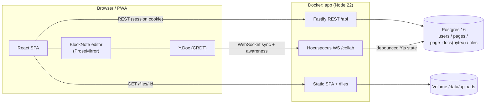
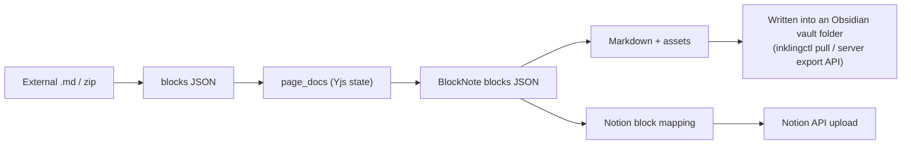

# Inkling 구조

English: [ARCHITECTURE.md](ARCHITECTURE.md).

## 개요

## 왜 CRDT(Yjs)인가

동시 편집에서 가장 중요한 문제는 "두 사람이 같은 문단을 동시에 고치면 누구 것이 남는가"입니다. Yjs는 CRDT(Conflict-free Replicated Data Type)이기 때문에 **업데이트가 어떤 순서로 도착하든 모든 클라이언트가 같은 결과에 이릅니다**. 서버는 누가 맞는지 판정하지 않고, 중계하고 저장하는 일만 합니다(Hocuspocus). 그래서 이런 점이 좋습니다.

- 입력이 로컬에 먼저 반영되기 때문에(낙관적 반영) Notion만큼 매끄럽게 편집할 수 있습니다
- 잠깐 오프라인이었던 동안 고친 내용은 다시 연결되면 저절로 합쳐집니다
- 서버 로직이 단순합니다(문서 상태 = bytea 스냅샷 하나)

편집기와 CRDT 핵심부(BlockNote/ProseMirror/Yjs)는 검증된 오픈소스 구성 요소를 가져다 썼고, 제품 자체(서버, 권한, 워크스페이스, 연동 파이프라인, UI)는 직접 만들었습니다.

## 인증

- 세션 쿠키(`inkling_sid`, httpOnly)로 인증합니다. REST 요청과 WebSocket 업그레이드 요청이 같은 쿠키를 씁니다.
- WS 권한 확인: documentName(= 페이지 id)으로 페이지를 찾고, 사용자가 그 페이지가 속한 워크스페이스의 멤버인지 확인합니다.

## Markdown 왕복 변환(M2/M4 설계 초안)

- 내보내기는 서버에서 합니다. Yjs 상태를 BlockNote 블록으로 바꾸고, 이것을 직접 만든 Markdown 직렬화(표, 코드, 이미지 포함)로 씁니다.
- 옵시디언: 맥에서 CLI(`inklingctl`)가 내보내기 API를 불러 Markdown과 첨부 파일을 볼트 경로에 씁니다.
- Notion: 블록 종류 대응표(제목/목록/표/코드/이미지)에 따라 올립니다. 이미지는 파일 업로드 API로 올립니다.

## 배포

- `docker compose up -d` 한 번으로 뜹니다. `db`(postgres:16-alpine)와 `app`이 함께 뜨고, `app`은 배포된 멀티 아키텍처 이미지 `ghcr.io/prove1352/inkling`을 쓰거나 `compose.build.yaml`로 소스에서 멀티 스테이지 빌드를 합니다(docs/adr/1050-*, 1051-*).
- 이미지는 모두 멀티 아키텍처(x86-64와 ARM64)라서 Apple Silicon 맥과 ARM 클라우드 VM에서도 그대로 돕니다.
- 데이터는 볼륨 두 개에 있습니다. `inkling_inkling-db`(Postgres)와 `inkling_inkling-data`(업로드한 파일)이고, 이름은 `INKLING_DATA_NAME`을 따라 붙습니다. 0.18 이하에서 설치한 서버는 예전 이름을 그대로 쓰고 있을 수 있습니다(docs/adr/2340-*).
