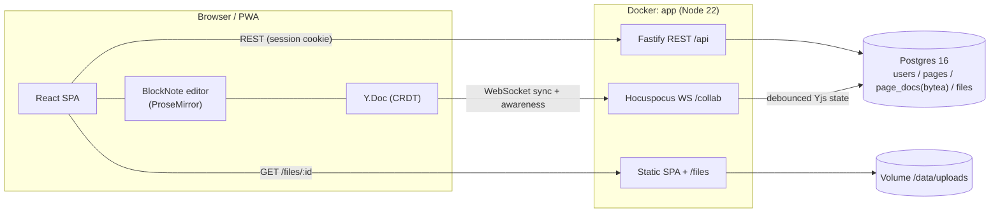
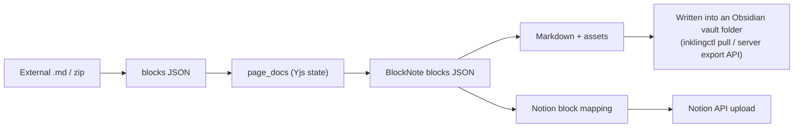

# Inkling Architecture

한국어: [ARCHITECTURE.ko.md](ARCHITECTURE.ko.md).

## Overview

## Why a CRDT (Yjs)

The core problem of concurrent editing is "if two people edit the same paragraph at the same time, who wins?"
Yjs is a CRDT (Conflict-free Replicated Data Type), so **every client converges on the same result no matter
what order the updates arrive in**. The server is not an arbiter; it only acts as a relay and a store
(Hocuspocus). As a result:

- Typing is local-first (optimistic), so editing feels as smooth as Notion
- Brief offline periods merge automatically on reconnect
- Server logic stays simple (document state = a bytea snapshot)

The editor and CRDT core (BlockNote/ProseMirror/Yjs) are proven open-source components;
the product itself (server, permissions, workspaces, integration pipelines, UI) is built in-house.

## Authentication

- Session cookie (`inkling_sid`, httpOnly). Both REST requests and WebSocket upgrade requests authenticate with the same cookie.
- WS authorization: documentName (= page id) → check that the user is a member of the page's workspace.

## Markdown round-trip (M2/M4 design sketch)

- Export runs on the server: Yjs state → BlockNote blocks → custom Markdown serialization (including tables, code and images).
- Obsidian: a CLI on the Mac (`inklingctl`) calls the export API and writes Markdown plus attachments into the vault path.
- Notion: upload driven by a block-type mapping table (headings/lists/tables/code/images); images use the file upload API.

## Deployment

- A single `docker compose up -d`: `db` (postgres:16-alpine) + `app` (the published multi-arch image `ghcr.io/prove1352/inkling`, or a multi-stage build from source with `compose.build.yaml`; docs/adr/1050-*, 1051-*).
- All images are multi-arch (x86-64 and ARM64) → they run as-is on Apple Silicon Macs and ARM cloud VMs.
- Data lives in two volumes: `inkling_inkling-db` (Postgres) and `inkling_inkling-data` (uploads), named after `INKLING_DATA_NAME` (an install from 0.18 or older may keep the old name, docs/adr/2340-*).
