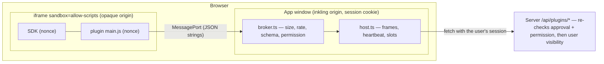

# 플러그인 (API v0, 실험 기능)

Inkling은 작은 서드파티 플러그인을 돌릴 수 있습니다. 플러그인은 **명령 팔레트 항목**과 **사용자 정의 블록**을 더하고, 페이지를 읽거나 (사용자의 확인을 받아) 쓰고, 사용자별로 약간의 데이터를 보관할 수 있습니다. 설계할 때 보안을 가장 먼저 생각했습니다. 모든 플러그인은 opaque origin(어느 출처에도 속하지 않는 origin)을 가진 샌드박스 iframe 안에서 돕니다. 네트워크에 접근할 수 없고, 앱의 쿠키, DOM, 저장소에도 손댈 수 없습니다. 플러그인은 서버 운영자만 설치할 수 있습니다. English: [PLUGINS.md](PLUGINS.md).

> 상태: **실험 기능**. `EXPERIMENTAL_FEATURES=plugins`로 켭니다. 플래그가 꺼져 있으면 플러그인 경로(route)를 하나도 등록하지 않고 플러그인 화면도 보여 주지 않습니다. 문서에 이미 들어 있는 플러그인 블록은 동작하지 않는 자리 표시로 그려지고, 데이터는 그대로 남습니다.

- [하지 않는 것: 옵시디언 호환](#non-goals-obsidian-compatibility)
- [플러그인 설치 (서버 운영자)](#installing-a-plugin-operators)
- [플러그인 만들기](#writing-a-plugin)
- [manifest.json 레퍼런스](#manifestjson-reference)
- [런타임 API 레퍼런스](#runtime-api-reference)
- [제한](#limits)
- [보안 모델](#security-model)
- [위협 점검 목록과 검증 현황](#threat-checklist-and-verification-status)
- [알려진 한계와 남은 위험](#known-limitations-and-residual-risks)
- [샌드박스 직접 검증하기](#verifying-the-sandbox-yourself)

<a id="non-goals-obsidian-compatibility"></a>
## 하지 않는 것: 옵시디언 호환

Inkling의 플러그인 API는 옵시디언 플러그인을 돌리려 하지 **않고**, 앞으로 그쪽으로 키워 갈 생각으로 설계하지도 않았습니다. 이유는 들일 노력의 문제가 아니라 구조에 있습니다.

1. **편집기와 저장 방식이 다릅니다.** 옵시디언 플러그인은 CodeMirror 편집기와 Markdown 파일 폴더를 다룹니다(`app.vault`, `app.workspace`, `MarkdownView`…). Inkling 문서는 BlockNote/ProseMirror로 그리는 Yjs CRDT이고, 사용자들 사이에 실시간으로 공유됩니다. "파일"이라는 것이 없고, 옵시디언 API 대부분은 뜻이 통하는 대응물이 없습니다.
2. **Electron/Node에 기대고 있습니다.** 옵시디언 플러그인은 Node.js와 Electron의 모든 권한(파일 시스템, 자식 프로세스, 아무 곳으로나 가는 네트워크)을 가지고 돕니다. 많은 사용자에게 서비스하는 웹 앱은 그런 권한을 서드파티 코드에 넘길 수 없고, 브라우저는 애초에 그런 권한을 줄 수도 없습니다.
3. **여러 사용자가 함께 쓰는 환경의 보안.** 옵시디언의 모델은 "사용자 한 명, 기계 한 대, 설치한 것은 믿는다"입니다. Inkling 서버는 여럿이 함께 씁니다. 플러그인은 *모든* 사용자의 브라우저에서 돌고, 사용자마다 볼 수 있는 범위가 다른 데이터(개인 구역, 워크스페이스 멤버십)를 다룹니다. 그래서 샌드박스, 명시적인 권한, 관리자 승인이 있어야 합니다. 옵시디언의 열린 모델과는 정반대입니다.

<a id="installing-a-plugin-operators"></a>
## 플러그인 설치 (서버 운영자)

플러그인은 **서버 운영자만** 설치합니다. v0에는 업로드나 앱 안에서 설치하는 기능이 없습니다.

1. 실험 기능을 켭니다: `EXPERIMENTAL_FEATURES=plugins`(다른 실험 기능과 함께 쓸 때는 쉼표로 구분합니다).
2. 플러그인마다 `PLUGINS_DIR`(기본값 `./data/plugins`, 곧 `DATA_DIR/plugins`) 아래에 디렉터리를 하나씩 두고 넣습니다.

   ```
   data/plugins/
     word-stats/
       manifest.json
       main.js          # the single pre-bundled entry named in manifest.json
   ```

   `main.js` 옆의 주석은 이 파일이 `manifest.json`에 적은, 미리 번들해 둔 진입 파일 하나라는 뜻입니다.

   디렉터리 이름은 매니페스트의 `id`와 같아야 합니다. 심볼릭 링크로 된 디렉터리와 파일은 무시합니다. 디렉터리 안의 다른 파일은 읽지도, 내보내지도 않습니다.
3. **관리자 › 플러그인 (실험적)**(`Admin → Plugins (experimental)`)을 엽니다. 설명, 요청한 권한, 선언한 명령과 블록을 검토합니다. 주고 싶지 않은 권한은 체크를 해제한 다음 **승인하고 켜기**(`Approve & enable`)를 누릅니다.

승인은 `manifest.json`과 진입 번들의 SHA-256에 묶입니다. 디스크에서 둘 중 하나라도 바뀌면(업데이트든 변조든) 플러그인은 바로 내보내지 않고 목록에서도 빠지며, 관리자가 새 내용을 승인할 때까지 **변경됨 — 다시 승인 필요**(`Changed — needs re-approval`)로 표시됩니다. **끄기**(`Disable`)는 플러그인을 끕니다. **승인 취소·데이터 삭제**(`Forget & delete data`)는 승인을 없애고, 모든 사용자가 그 플러그인에 저장한 데이터를 지웁니다.

예제 플러그인은 [`examples/plugins/`](../examples/plugins)에 있습니다. `word-stats`(명령, 알림 메시지, 저장소)와 `progress-bar`(사용자 정의 블록 두 개)입니다. 일부러 악의적으로 만든 테스트 플러그인 `security-probe`는 서버 테스트와 함께 [`apps/server/src/plugins/fixtures/`](../apps/server/src/plugins/fixtures)에 있습니다. 실제 서버에서는 절대 켜지 마세요.

<a id="writing-a-plugin"></a>
## 플러그인 만들기

플러그인은 평범한 JavaScript 파일 하나와 매니페스트로 이루어집니다. 앱은 스크립트가 실행되기 전에 고정된(frozen) 전역 객체 `inkling`(SDK)을 넣어 줍니다. 빌드 단계가 꼭 있어야 하는 것은 아닙니다. 의존성을 쓴다면 진입 파일 하나(≤ 1 MB)에 번들해 넣으세요. 스크립트는 샌드박스 문서 안에서 실행되고, 그 안의 조건은 이렇습니다.

- 네트워크를 쓸 수 없습니다(`fetch`, XHR, WebSocket, EventSource, 비콘, 원격 이미지가 모두 막힙니다).
- 쿠키, `localStorage`, `sessionStorage`, IndexedDB가 없습니다(opaque origin).
- `eval`/`new Function`을 쓸 수 없고, `<script>` 요소를 더 넣을 수도 없습니다(nonce로 고정한 스크립트 두 개만 실행됩니다).
- 인라인 스타일은 됩니다(`<style>`과 `style=`). 이미지는 `data:`/`blob:` URL만 됩니다.

```js
// main.js — a command
inkling.commands.register('count-words', async (ctx) => {
  if (!ctx.pageId) return inkling.ui.notice('Open a page first.')
  const page = await inkling.pages.get(ctx.pageId)        // needs "read:pages"
  const words = (page.markdown.match(/\p{L}+/gu) || []).length
  await inkling.ui.notice(`${words} words`)
})
```

명령을 등록하는 예입니다. `inkling.pages.get` 줄의 주석은 이 호출에 `read:pages` 권한이 필요하다는 뜻입니다.

```js
// main.js — a block
inkling.blocks.register('counter', {
  render(root, { data, editable, setData }) {
    root.textContent = ''
    const b = document.createElement('button')
    b.textContent = `Count: ${data.count ?? 0}`
    b.disabled = !editable
    b.onclick = () => setData({ ...data, count: (data.count ?? 0) + 1 })
    root.append(b)
  },
  // optional: update(root, props) — called instead of render() on later data changes
})
```

블록을 등록하는 예입니다. 끝의 주석은 `update(root, props)`를 넣어도 된다는 뜻이고, 넣으면 그 뒤 데이터가 바뀔 때 `render()` 대신 불립니다.

등록하는 명령 id와 블록 타입은 모두 `manifest.json`에 선언해 두어야 합니다. 선언하지 않은 것은 거절합니다.

<a id="manifestjson-reference"></a>
## manifest.json 레퍼런스

```json
{
  "id": "progress-bar",
  "name": "Progress Blocks",
  "version": "1.0.0",
  "minAppVersion": "0.1.0",
  "description": "Optional, ≤ 300 chars",
  "author": "Optional, ≤ 100 chars",
  "entry": "main.js",
  "permissions": ["blocks"],
  "commands": [{ "id": "count-words", "title": "Word stats: count words" }],
  "blocks": [
    {
      "type": "progress",
      "title": "Progress bar",
      "description": "Optional slash-menu subtitle",
      "defaultData": { "value": 30, "max": 100 },
      "height": 72
    }
  ]
}
```

예시의 `description`과 `author`는 넣지 않아도 되고 각각 300자, 100자까지입니다. 블록의 `description`은 슬래시 메뉴에 나오는 부제목이고, 이것도 넣지 않아도 됩니다.

| 필드 | 규칙 |
| --- | --- |
| `id` | `^[a-z0-9][a-z0-9-]{1,63}$`, 디렉터리 이름과 같아야 합니다 |
| `name` | 1–60자 |
| `version`, `minAppVersion` | semver `x.y.z`. `minAppVersion`이 서버 버전보다 높으면 거절합니다 |
| `entry` | `.js`로 끝나는 파일 이름만(`/`, `\`, `..` 없이), 일반 파일, ≤ 1 MB |
| `permissions` | `commands`, `read:pages`, `write:pages`, `blocks`, `storage` 가운데 일부. 중복은 안 됩니다 |
| `commands` | ≤ 20개. `id`는 `^[a-z0-9][a-z0-9-]{0,63}$`, `title`은 1–80자. `commands` 권한이 있어야 합니다 |
| `blocks` | ≤ 10개. `type`은 같은 패턴, `title`은 1–60자. `defaultData`는 4 KB 이하의 JSON 객체, `height`는 40–800 px. `blocks` 권한이 있어야 합니다 |

모르는 키는 거절합니다(엄격한 스키마). `manifest.json` 자체는 64 KB 이하여야 합니다.

<a id="runtime-api-reference"></a>
## 런타임 API 레퍼런스

모든 메서드는 Promise를 돌려줍니다. 실패하면 `Error`로 reject되고, 그 `code`는 `PERMISSION_DENIED`, `BAD_REQUEST`, `NOT_DECLARED`, `BUSY`, `RATE_LIMITED`, `DENIED`, `TIMEOUT`, `READ_ONLY` 가운데 하나이거나 서버 오류 코드(`NOT_FOUND`, `PLUGIN_PERMISSION`, `PLUGIN_STORAGE_QUOTA`…)입니다.

| API | 권한 | 설명 |
| --- | --- | --- |
| `inkling.ready` | – | 핸드셰이크가 끝나면 컨텍스트로 resolve되는 Promise |
| `inkling.context()` | – | `{ pluginId, mode: 'worker'\|'block', workspaceId, pageId, theme, blockType, data, editable }` |
| `inkling.commands.register(id, handler)` | `commands` | `handler(ctx)`는 사용자가 명령을 실행한 페이지의 `{ workspaceId, pageId }`를 받습니다 |
| `inkling.blocks.register(type, { render, update? })` | `blocks` | `render(root, { data, editable, setData })` |
| `setData(data)`(블록 안에서) | `blocks` | 블록의 JSON(≤ 16 KB)을 문서에 저장합니다. 읽기 전용이면 거절하고, 초당 4번 이하로 묶어서 씁니다 |
| `inkling.pages.get(pageId)` | `read:pages` | `{ id, workspaceId, title, kind, updatedAt, markdown }`. 볼 수 있는 범위는 사용자와 정확히 같습니다 |
| `inkling.pages.search(query, workspaceId?)` | `read:pages` | 결과 ≤ 20개 `{ id, title, kind, updatedAt, snippet }`. 기본값은 지금 워크스페이스입니다 |
| `inkling.pages.update(pageId, markdown, { mode })` | `write:pages` | `mode`: `replace`(기본값) 또는 `append`. 부를 때마다 사용자가 확인하고, `replace`는 스냅샷을 남깁니다 |
| `inkling.storage.get(key)` / `set(key, value)` / `delete(key)` / `keys()` | `storage` | 플러그인별 **그리고** 사용자별로 따로 저장합니다. 키는 `^[A-Za-z0-9_.:-]{1,128}$`, 값은 JSON |
| `inkling.ui.notice(message)` | – | 토스트 알림. 앞에 플러그인 이름이 붙고, ≤ 300자, 초당 1번 이하 |

블록 프레임은 크기를 스스로 맞춥니다(SDK가 본문 높이를 알려 주고, 40–1200 px 안으로 제한합니다). 테마가 바뀌면 `<html>`에 `data-theme="light|dark"`로 반영됩니다.

<a id="rest-endpoints-used-by-the-app-not-by-plugins"></a>
### REST 엔드포인트 (플러그인이 아니라 앱이 씀)

[API.md](API.md#plugins-experimental)를 보세요. 플러그인은 서버를 부를 수 없습니다. 앱(부모 창)이 승인된 권한을 확인한 뒤, 사용자 자신의 세션으로 이 엔드포인트들을 부릅니다.

<a id="limits"></a>
## 제한

| 제한 | 값 | 적용하는 곳 |
| --- | --- | --- |
| 들어오는 메시지 크기 | 256 KB(문자열만) | 부모 브로커 |
| 프레임당 메시지 속도 | 순간 60개, 평소 초당 30개 | 부모 브로커 |
| 강제 종료 전까지 허용하는 위반 | 100번(너무 큰 메시지는 3번) | 부모 브로커 |
| 프레임당 동시 RPC | 16 | 부모 브로커 |
| 하트비트 | 4초마다 ping, 12초 동안 pong이 없으면 종료 | 부모 호스트 |
| 핸드셰이크 / 명령 등록 | 10초 / 5초 | 부모 호스트 |
| 동시에 살아 있는 플러그인 프레임 | 8개(쉬고 있는 명령 워커부터 내보냄) | 부모 호스트 |
| 쉬고 있는 명령 워커 | 60초 뒤 정리 | 부모 호스트 |
| 블록 프레임 | 화면에 (거의) 보일 때만 만들고, 화면을 벗어나면 3초 뒤 지움 | 부모 호스트 |
| `pages.update` | 플러그인마다 확인 대기 하나, 3초 이상 간격. 서버에서는 IP당 분당 30번 | 부모 호스트 + 서버 |
| 저장소 | 값 64 KB, 키 500개, 플러그인별·사용자별 합계 1 MB | 서버 |
| 번들 / 매니페스트 | 1 MB / 64 KB, 플러그인 디렉터리는 50개까지만 훑음 | 서버 |

<a id="security-model"></a>
## 보안 모델



**신뢰 경계.** *어떤 코드*를 돌릴지는 관리자가 정합니다(해시에 묶인 승인). *그 코드가 무엇을 건드릴 수 있는지*는 샌드박스가 정합니다. 건드릴 수 있는 것은 MessagePort 하나뿐입니다. *어떤 요청*을 들어줄지는 부모가 정합니다(승인된 권한, 선언한 명령과 블록, 제한). *사용자가 어떤 데이터*를 볼 수 있는지는 서버가 정하고(앱의 나머지 부분과 같은 공개 범위·멤버십 검사), 그와 따로 플러그인이 켜져 있고 해당 권한을 가졌는지도 서버가 다시 확인합니다.

1. **격리.** `<iframe sandbox="allow-scripts">`을 쓰고 `allow-same-origin`은 절대 붙이지 않습니다. 그래서 프레임은 opaque origin을 가지고, 쿠키와 Web Storage가 없으며, `window.parent`의 DOM에 접근할 수 없습니다. 프레임 문서는 자체 CSP를 달고 나갑니다. 이 CSP에는 `sandbox allow-scripts`가 다시 들어 있어서 최상위 페이지로 열어도 opaque origin이 됩니다. 그 밖에 `default-src 'none'`, `script-src 'nonce-…'`(응답마다 새 nonce를 쓰고, SDK와 승인된 번들만 실행됩니다), `connect-src 'none'`, `form-action 'none'`, `base-uri 'none'`, `frame-ancestors 'self'`가 있고, 여기에 `nosniff`, `Referrer-Policy: no-referrer`, 모든 것을 거부하는 `Permissions-Policy`가 더해집니다. iframe에는 `allow=""`, `referrerpolicy="no-referrer"`가 붙고, 지원하는 브라우저에서는 `credentialless`도 붙습니다.
2. **채널.** 프레임이 처음 `load`되면 부모가 `postMessage(…, '*', [port])`로 바로 그 `contentWindow`에 `MessagePort`를 넘깁니다. opaque origin은 이름으로 가리킬 수 없어서 `'*'`가 꼭 필요합니다. 권한을 주는 것은 origin이 아니라 포트입니다. 그 뒤로 오가는 것은 모두 이 포트를 거치므로 다른 창이 메시지를 끼워 넣을 수 없고, 부모는 아무것도 브로드캐스트하지 않습니다. 두 번째 `load`가 일어나면(플러그인이 자기 프레임을 다른 곳으로 이동시킨 경우) 프레임을 종료합니다.
3. **부모 브로커.** 모든 메시지는 256 KB 이하의 JSON 문자열이어야 하고(파싱하기 전에 확인합니다), 토큰 버킷을 통과해야 하며, 양의 정수인 요청 id와 알려진 메서드, 올바른 인자를 담아야 합니다. 페이지 id는 UUID여야 하므로 프록시하는 URL에 무언가를 끼워 넣을 수 없습니다. 메서드의 권한은 **승인된** 권한 목록에 있어야 합니다. 응답에는 요청 id가 붙습니다.
4. **서버.** `/api/plugins/:id/*` 경로는 쿠키 세션으로만 부를 수 있습니다(MCP bearer 토큰은 안 됩니다). 플러그인이 승인되어 켜져 있고 디스크의 해시도 아직 맞을 때만 답하고, 아니면 404를 돌려줍니다. 권한을 한 번 더 확인한 다음, 앱이 쓰는 것과 같은 검사를 거칩니다(`findVisiblePage` + `requireMembership`, 또는 사용자 자신의 쿠키를 붙여 기존 경로로 보내는 내부 요청). 플러그인용 토큰은 없습니다. 플러그인은 로그인한 사용자 말고 다른 누구로도 행동할 수 없고, 그 사용자가 볼 수 있는 것보다 더 많이 볼 수도 없습니다.
5. **공급망.** 설치 API가 없습니다. 파일은 `PLUGINS_DIR`에서만 읽고, 심볼릭 링크는 거절하고, 진입 파일은 플러그인 디렉터리 안으로 한정하고, 승인은 내용 해시에 묶습니다. 관리자는 자기가 검토한 해시를 승인합니다(그사이 파일이 바뀌었으면 409).

<a id="threat-checklist-and-verification-status"></a>
## 위협 점검 목록과 검증 현황

"브라우저" 행은 실제 부모 브로커와 서버가 내보낸 실제 프레임으로 **headless Chrome 157**에서 돌려 보았습니다(하네스는 `apps/server/src/plugins/browser-harness/`에 있습니다). "서버" 행은 `plugins.test.ts`와 HTTP 스모크 테스트가 확인합니다. 다른 브라우저는 **검증하지 않았습니다**.

| 악의적인 동작 | 기대하는 결과 | 현황 |
| --- | --- | --- |
| 부모 DOM 읽기(`window.parent.document`, `top.document`) | `SecurityError` | 브라우저 ✔ (Chrome) |
| `document.cookie` 읽기/쓰기 | `SecurityError` | 브라우저 ✔ (Chrome) |
| `localStorage` | `SecurityError` | 브라우저 ✔ (Chrome) |
| 같은 origin의 API나 외부로 `fetch`, XHR, WebSocket | CSP가 막음 | 브라우저 ✔ (Chrome) |
| nonce 없는 `<script>` 끼워 넣기, `eval` | CSP가 막음 | 브라우저 ✔ (Chrome) |
| `window.open` 팝업, 원격 이미지 비콘 | 막힘(sandbox / CSP) | 브라우저 ✔ (Chrome) |
| 프레임 URL을 최상위 페이지로 열기 | opaque origin(`self.origin === "null"`), 쿠키·저장소 없음 | 브라우저 ✔ (Chrome) |
| `write:pages` 없이 `pages.update` | 부모에서 `PERMISSION_DENIED`, 서버에서 403 | 브라우저 ✔ + 서버 ✔ + 단위 테스트 |
| 선언하지 않은 명령/블록 | `NOT_DECLARED` | 단위 테스트 |
| 너무 큰 메시지(2 MB × 5) | 파싱 전에 버리고, 3번째에 프레임 종료 | 브라우저 ✔ + 단위 테스트 |
| 메시지 폭주(메시지 20 000개) | 순간 허용량 이하만 핸들러에 닿고, 프레임 종료 | 브라우저 ✔ + 단위 테스트 |
| 무한 루프 | 12초 동안 pong이 없으면 프레임을 없애고, 앱은 계속 반응함 | 브라우저 ✔ (Chrome은 샌드박스 프레임을 별도 프로세스에서 돌립니다). **다른 브라우저는 검증 안 됨** |
| 자기 프레임 이동시키기 | 두 번째 `load` → 프레임 종료 | 브라우저 ✔ (Chrome) |
| 플러그인으로 다른 사용자의 개인 페이지 읽기 | 404 | 서버 ✔ |
| 다른 사용자나 다른 플러그인의 플러그인 저장소 | (플러그인, 사용자) 키로 분리 | 서버 ✔ |
| 승인한 뒤 번들 바꿔치기 | 다시 승인할 때까지 내보내지 않고 목록에도 없음 | 서버 ✔ |
| 플러그인 디렉터리, 진입 파일, URL에서 경로 탐색 / 심볼릭 링크 | 거절 / 404 | 서버 ✔ |
| 낡은 해시나 요청하지 않은 권한으로 승인 | 409 / 400 | 서버 ✔ |
| 앱 토스트 알림 흉내 | 알림 앞에 언제나 플러그인 이름이 붙음 | 구조상 보장 |
| 쓰기 확인 창 남발 | 플러그인마다 대기 하나, 3초 이상 간격 | 구조상 보장(브라우저에서는 시험 안 함) |
| 앱 통합: 슬래시 메뉴가 `pluginBlock`을 넣고, 블록 프레임이 그려지고 크기가 저절로 맞춰지며, 팔레트 명령이 숨은 워커 프레임에서 돌고 알림을 띄우고, 관리자 화면이 그려짐 | 동작함 | 브라우저 ✔ (Chrome, 버려도 되는 서버에 붙인 vite dev) |
| `write:pages`가 *있을 때* `pages.update`(확인 대화 상자 → 스냅샷 → 쓰기) | 사용자가 확인 | **브라우저에서 검증 안 됨**(서버 경로는 기존 콘텐츠 경로의 테스트가 다룹니다) |
| 블록 안에서 클릭해 시작한 `setData` 왕복, 다른 사람의 변경이 프레임으로 다시 들어감 | 문서가 바뀜 / 프레임이 다시 그려짐 | **브라우저에서 검증 안 됨** |
| 보이는 플러그인 프레임이 8개를 넘음(슬롯 상한, LRU 워커 내보내기, "일시 정지" 자리 표시) | 상한 적용 | **브라우저에서 검증 안 됨** |
| 위 모든 항목의 Firefox / Safari 동작 | — | **검증 안 됨** |

<a id="known-limitations-and-residual-risks"></a>
## 알려진 한계와 남은 위험

- **이동을 이용한 데이터 유출.** 브라우저에는 프레임이 스스로 다른 곳으로 이동하는 것을 막을 방법이 없습니다(`navigate-to`는 끝내 나오지 않았습니다). `read:pages`를 받은 악의적인 플러그인은 자기 프레임을 이동시켜서 읽은 내용을 다른 사이트로 보낼 수 있습니다. 부모가 이동을 알아채고 프레임을 종료하지만, 요청은 이미 나간 뒤입니다. 그래서 *플러그인이 읽도록 허락받은 데이터*에 대해서는 관리자 승인이 신뢰 경계입니다. 그 밖의 모든 것(세션, 다른 데이터, 앱 화면)은 샌드박스가 지킵니다.
- **로드 전 이동.** 플러그인이 맨 처음 로드되는 동안 이동하면, 핸드셰이크 포트는 이동해 간 페이지로 전달됩니다. 그 페이지가 가진 힘은 플러그인 자신과 같지만(같은 권한, 같은 opaque 샌드박스), 우리 CSP의 제약은 더는 받지 않습니다.
- **같은 프로세스에서 프레임을 돌리는 브라우저.** 바쁘게 돌고 있는 프레임을 종료하려면 부모가 계속 돌아가야 합니다. Chrome은 샌드박스 프레임을 별도 프로세스로 격리합니다(검증함). 그렇게 하지 않는 브라우저에서는 그 브라우저의 "페이지 응답 없음" 처리가 작동할 때까지 탭 전체가 멈춥니다.
- **서버 내보내기.** `pageEmbed`/`callout`과 마찬가지로 서버 쪽 BlockNote 스키마는 `pluginBlock`을 모릅니다. 그래서 Markdown/Notion 내보내기와 서버 쪽 Markdown 쓰기에서는 플러그인 블록이 빠집니다. 실시간 문서에는 블록이 그대로 남습니다.
- 프레임 안에서는 `style-src 'unsafe-inline'`을 허용합니다(opaque 샌드박스 안에서는 스타일이 해가 되지 않습니다). 글꼴과 이미지는 `data:`/`blob:`만 됩니다.
- v0에는 플러그인 설정 화면, 워크스페이스별로 켜고 끄기, 업데이트 채널이 없습니다.
- 읽기 전용 트랜스클루전 뷰어(`![[page]]` 임베드)는 `pluginBlock`이 없는 자체 스키마를 씁니다. 그래서 임베드 안에서는 플러그인 블록이 보이지 않습니다(원래 페이지에는 영향이 없습니다).
- 프레임 자원(`/api/plugin-frame/…`, `/api/plugin-sdk/…`)은 일부러 인증 없이 엽니다(opaque origin 프레임은 쿠키를 보내지 않습니다). 이 자원은 승인된 플러그인에만 있고, 승인된 번들만 내보냅니다.

<a id="verifying-the-sandbox-yourself"></a>
## 샌드박스 직접 검증하기

1. `EXPERIMENTAL_FEATURES=plugins`로 버려도 되는 서버를 띄웁니다. `PLUGINS_DIR`는 `examples/plugins/*`와 `apps/server/src/plugins/fixtures/*`를 모두 복사해 둔 임시 디렉터리를 가리키게 하고, `WEB_DIST=<harness dir>`도 넣습니다. `admin@example.com` / `password123`으로 가입하고, `security-probe`(`commands`, `read:pages`)와 `progress-bar`를 승인합니다.
2. `apps/server/src/plugins/browser-harness/run.sh <harness dir>`를 실행하고(하네스를 복사하고 실제 `broker.ts`를 esbuild로 번들합니다), 파일이 제공되도록 서버를 다시 시작합니다.
3. `--remote-debugging-port=9613`으로 headless Chrome을 띄운 뒤 `node cdp.mjs`를 실행합니다. `escape`의 모든 프로브는 `:ok`를 찍어야 하고, `write`는 `PERMISSION_DENIED`여야 하며, `huge`/`flood`/`navigate`/`loop`는 각각 `oversize`/`flood`/`navigated`/`unresponsive`를 보고해야 합니다.

단위 테스트: `cd apps/server && npx tsx --test src/plugins/plugins.test.ts ../web/src/plugins/broker.test.ts`.
