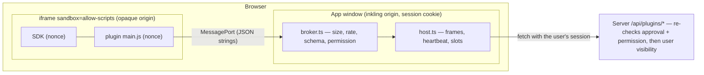

# Plugins (API v0, experimental)

Inkling can run small third-party plugins that add **command palette entries** and **custom
blocks**, read or (with confirmation) write pages, and keep a little per-user data. Security comes
first: every plugin runs in a sandboxed iframe with an opaque origin, no network access and no
access to the app's cookies, DOM or storage. Only the server operator can install plugins. 한국어: [PLUGINS.ko.md](PLUGINS.ko.md).

> Status: **experimental**. Enable with `EXPERIMENTAL_FEATURES=plugins`. With the flag off, no
> plugin route is registered and no plugin UI is shown; plugin blocks already in documents render
> as inert placeholders and keep their data.

- [Non-goals: Obsidian compatibility](#non-goals-obsidian-compatibility)
- [Installing a plugin (operators)](#installing-a-plugin-operators)
- [Writing a plugin](#writing-a-plugin)
- [manifest.json reference](#manifestjson-reference)
- [Runtime API reference](#runtime-api-reference)
- [Limits](#limits)
- [Security model](#security-model)
- [Threat checklist and verification status](#threat-checklist-and-verification-status)
- [Known limitations and residual risks](#known-limitations-and-residual-risks)
- [Verifying the sandbox yourself](#verifying-the-sandbox-yourself)

## Non-goals: Obsidian compatibility

Inkling's plugin API does **not** try to run Obsidian plugins, and is not designed to grow into
that. The reasons are structural, not a matter of effort:

1. **Different editor and storage model.** Obsidian plugins manipulate a CodeMirror editor and a
   folder of Markdown files (`app.vault`, `app.workspace`, `MarkdownView`…). Inkling documents are
   Yjs CRDTs rendered by BlockNote/ProseMirror and shared live between users; "the file" does not
   exist and most Obsidian APIs have no meaningful equivalent.
2. **Electron/Node dependence.** Obsidian plugins run with full Node.js and Electron privileges
   (filesystem, child processes, arbitrary network). A web app that serves many users cannot hand
   that to third-party code, and a browser cannot provide it anyway.
3. **Multi-user security.** Obsidian's model is "one user, one machine, trust what you install".
   An Inkling server is shared: a plugin runs in *every* user's browser, against data with
   per-user visibility (private sections, workspace membership). That demands sandboxing,
   explicit permissions and administrator approval — the opposite of Obsidian's open model.

## Installing a plugin (operators)

Plugins are installed **only by the server operator**; there is no upload or in-app install in v0.

1. Enable the experiment: `EXPERIMENTAL_FEATURES=plugins` (comma-separated with other experiments).
2. Put each plugin in its own directory under `PLUGINS_DIR` (default `./data/plugins`, i.e.
   `DATA_DIR/plugins`):

   ```
   data/plugins/
     word-stats/
       manifest.json
       main.js          # the single pre-bundled entry named in manifest.json
   ```

   The directory name must equal the manifest `id`. Symlinked directories/files are ignored.
   Nothing else in the directory is ever read or served.
3. Open **Admin → Plugins (experimental)**. Review the description, the requested permissions and
   the declared commands/blocks. Untick any permission you do not want to grant, then
   **Approve & enable**.

Approval is pinned to a SHA-256 of `manifest.json` + the entry bundle. If either file changes on
disk (an update, or tampering), the plugin immediately stops being served or listed and shows
**Changed — needs re-approval** until an administrator approves the new content. **Disable** turns
a plugin off; **Forget & delete data** removes the approval and every user's stored data for it.

Example plugins live in [`examples/plugins/`](../examples/plugins): `word-stats` (command + notice
+ storage) and `progress-bar` (two custom blocks). The deliberately malicious test plugin
`security-probe` lives with the server tests in
[`apps/server/src/plugins/fixtures/`](../apps/server/src/plugins/fixtures) — never enable it on a
real server.

## Writing a plugin

A plugin is one plain JavaScript file plus a manifest. The app injects a frozen global `inkling`
(the SDK) before your script runs. There is no build step requirement; if you use dependencies,
bundle them into the single entry file (≤ 1 MB). The script runs in a sandboxed document with:

- no network (`fetch`, XHR, WebSocket, EventSource, beacons and remote images are all blocked),
- no cookies, `localStorage`, `sessionStorage` or IndexedDB (opaque origin),
- no `eval`/`new Function`, no extra `<script>` elements (only the two nonce-pinned scripts run),
- inline styles allowed (`<style>` and `style=`), images only from `data:`/`blob:` URLs.

```js
// main.js — a command
inkling.commands.register('count-words', async (ctx) => {
  if (!ctx.pageId) return inkling.ui.notice('Open a page first.')
  const page = await inkling.pages.get(ctx.pageId)        // needs "read:pages"
  const words = (page.markdown.match(/\p{L}+/gu) || []).length
  await inkling.ui.notice(`${words} words`)
})
```

```js
// main.js — a block
inkling.blocks.register('counter', {
  render(root, { data, editable, setData }) {
    root.textContent = ''
    const b = document.createElement('button')
    b.textContent = `Count: ${data.count ?? 0}`
    b.disabled = !editable
    b.onclick = () => setData({ ...data, count: (data.count ?? 0) + 1 })
    root.append(b)
  },
  // optional: update(root, props) — called instead of render() on later data changes
})
```

Every command id and block type you register must be declared in `manifest.json`; anything else
is refused.

## manifest.json reference

```json
{
  "id": "progress-bar",
  "name": "Progress Blocks",
  "version": "1.0.0",
  "minAppVersion": "0.1.0",
  "description": "Optional, ≤ 300 chars",
  "author": "Optional, ≤ 100 chars",
  "entry": "main.js",
  "permissions": ["blocks"],
  "commands": [{ "id": "count-words", "title": "Word stats: count words" }],
  "blocks": [
    {
      "type": "progress",
      "title": "Progress bar",
      "description": "Optional slash-menu subtitle",
      "defaultData": { "value": 30, "max": 100 },
      "height": 72
    }
  ]
}
```

| Field | Rules |
| --- | --- |
| `id` | `^[a-z0-9][a-z0-9-]{1,63}$`, equal to the directory name |
| `name` | 1–60 chars |
| `version`, `minAppVersion` | semver `x.y.z`; `minAppVersion` greater than the server's version is rejected |
| `entry` | bare file name ending in `.js` (no `/`, `\`, `..`), regular file, ≤ 1 MB |
| `permissions` | subset of `commands`, `read:pages`, `write:pages`, `blocks`, `storage`; no repeats |
| `commands` | ≤ 20; `id` `^[a-z0-9][a-z0-9-]{0,63}$`, `title` 1–80 chars; requires `commands` |
| `blocks` | ≤ 10; `type` same pattern, `title` 1–60; `defaultData` JSON object ≤ 4 KB; `height` 40–800 px; requires `blocks` |

Unknown keys are rejected (strict schema). `manifest.json` itself must be ≤ 64 KB.

## Runtime API reference

All methods return Promises. Failures reject with an `Error` whose `code` is one of
`PERMISSION_DENIED`, `BAD_REQUEST`, `NOT_DECLARED`, `BUSY`, `RATE_LIMITED`, `DENIED`, `TIMEOUT`,
`READ_ONLY`, or a server error code (`NOT_FOUND`, `PLUGIN_PERMISSION`, `PLUGIN_STORAGE_QUOTA`…).

| API | Permission | Notes |
| --- | --- | --- |
| `inkling.ready` | – | Promise resolving to the context after the handshake |
| `inkling.context()` | – | `{ pluginId, mode: 'worker'\|'block', workspaceId, pageId, theme, blockType, data, editable }` |
| `inkling.commands.register(id, handler)` | `commands` | `handler(ctx)` gets `{ workspaceId, pageId }` of the page the user ran it on |
| `inkling.blocks.register(type, { render, update? })` | `blocks` | `render(root, { data, editable, setData })` |
| `setData(data)` (inside a block) | `blocks` | Saves the block's JSON (≤ 16 KB) into the document; refused when read-only; coalesced to ≤ 4 writes/s |
| `inkling.pages.get(pageId)` | `read:pages` | `{ id, workspaceId, title, kind, updatedAt, markdown }`; exactly the user's visibility |
| `inkling.pages.search(query, workspaceId?)` | `read:pages` | ≤ 20 results `{ id, title, kind, updatedAt, snippet }`; defaults to the current workspace |
| `inkling.pages.update(pageId, markdown, { mode })` | `write:pages` | `mode`: `replace` (default) or `append`. The user confirms every call; `replace` keeps a snapshot |
| `inkling.storage.get(key)` / `set(key, value)` / `delete(key)` / `keys()` | `storage` | Per plugin **and** per user; key `^[A-Za-z0-9_.:-]{1,128}$`, JSON value |
| `inkling.ui.notice(message)` | – | Toast, prefixed with the plugin name, ≤ 300 chars, ≤ 1/s |

Block frames resize themselves automatically (the SDK reports the body height; clamped to
40–1200 px). Theme changes are applied as `data-theme="light|dark"` on `<html>`.

### REST endpoints (used by the app, not by plugins)

See [API.md](API.md#plugins-experimental). Plugins cannot call the server: the app (parent window)
calls these with the user's own session after checking the approved permissions.

## Limits

| Limit | Value | Enforced in |
| --- | --- | --- |
| Incoming message size | 256 KB (strings only) | parent broker |
| Message rate per frame | burst 60, 30/s steady | parent broker |
| Violations before kill | 100 (or 3 oversized messages) | parent broker |
| Concurrent RPCs per frame | 16 | parent broker |
| Heartbeat | ping every 4 s, killed after 12 s without pong | parent host |
| Handshake / command registration | 10 s / 5 s | parent host |
| Plugin frames alive at once | 8 (idle command workers evicted first) | parent host |
| Idle command worker | torn down after 60 s | parent host |
| Block frames | created only when (nearly) on screen, removed 3 s after leaving it | parent host |
| `pages.update` | one pending confirmation per plugin, ≥ 3 s apart; 30/min/IP server-side | parent host + server |
| Storage | value 64 KB, 500 keys, 1 MB total per plugin per user | server |
| Bundle / manifest | 1 MB / 64 KB, ≤ 50 plugin directories scanned | server |

## Security model



**Trust boundaries.** The administrator decides *which code* runs (approval pinned to a hash).
The sandbox decides *what that code can touch*: nothing but one MessagePort. The parent decides
*which requests* are honoured (approved permissions, declared contributions, limits). The server
decides *which data* the user may see (the same visibility/membership checks as the rest of the
app), and independently re-checks that the plugin is active and holds the permission.

1. **Isolation.** `<iframe sandbox="allow-scripts">` — never `allow-same-origin`, so the frame has
   an opaque origin: no cookies, no Web Storage, no access to `window.parent`'s DOM. The frame
   document is served with its own CSP that repeats `sandbox allow-scripts` (so it is opaque even
   when opened as a top-level page), `default-src 'none'`, `script-src 'nonce-…'` (fresh nonce
   per response; only the SDK and the approved bundle run), `connect-src 'none'`,
   `form-action 'none'`, `base-uri 'none'`, `frame-ancestors 'self'`, plus `nosniff`,
   `Referrer-Policy: no-referrer` and a deny-all `Permissions-Policy`. The iframe also gets
   `allow=""`, `referrerpolicy="no-referrer"` and `credentialless` where supported.
2. **Channel.** On the frame's first `load`, the parent transfers a `MessagePort` with
   `postMessage(…, '*', [port])` to that exact `contentWindow` (an opaque origin cannot be named,
   so `'*'` is required; the capability is the port, not the origin). All further traffic uses the
   port, so other windows cannot inject messages and the parent never broadcasts. A second `load`
   (the plugin navigated its frame) kills the frame.
3. **Parent broker.** Every message must be a JSON string ≤ 256 KB (checked before parsing), pass
   the token bucket, carry a positive integer request id and a known method with valid params
   (UUIDs for page ids, so nothing can be injected into proxied URLs), and the method's permission
   must be in the **approved** set. Responses carry the request id.
4. **Server.** `/api/plugins/:id/*` routes are cookie-session only (no MCP bearer tokens), return
   404 unless the plugin is approved, enabled and its on-disk hash still matches, check the
   permission again, then call the same guards the app uses (`findVisiblePage` +
   `requireMembership`, or an internal request to the existing route with the user's own cookie).
   There are no plugin tokens: a plugin can never act as anyone but the signed-in user, and never
   see more than that user can.
5. **Supply chain.** No install API; files are read from `PLUGINS_DIR` only, symlinks refused,
   entry confined to the plugin directory, approval bound to content hash, admin approves the hash
   they reviewed (409 if the files changed in between).

## Threat checklist and verification status

"Browser" rows were exercised with the real parent broker and real server-served frames in
**headless Chrome 157** (harness in `apps/server/src/plugins/browser-harness/`). "Server" rows are
covered by `plugins.test.ts` and the HTTP smoke. Other browsers are **not verified**.

| Malicious behaviour | Expected | Status |
| --- | --- | --- |
| Read parent DOM (`window.parent.document`, `top.document`) | `SecurityError` | Browser ✔ (Chrome) |
| Read/write `document.cookie` | `SecurityError` | Browser ✔ (Chrome) |
| `localStorage` | `SecurityError` | Browser ✔ (Chrome) |
| `fetch` same-origin API / external, XHR, WebSocket | blocked by CSP | Browser ✔ (Chrome) |
| Inject `<script>` without nonce, `eval` | blocked by CSP | Browser ✔ (Chrome) |
| `window.open` popup, remote image beacon | blocked (sandbox / CSP) | Browser ✔ (Chrome) |
| Frame URL opened top-level | opaque origin (`self.origin === "null"`), no cookie/storage | Browser ✔ (Chrome) |
| `pages.update` without `write:pages` | `PERMISSION_DENIED` in parent; 403 server | Browser ✔ + Server ✔ + unit |
| Undeclared command/block | `NOT_DECLARED` | unit |
| Oversized messages (2 MB × 5) | dropped before parse, frame killed after 3 | Browser ✔ + unit |
| Message flood (20 000 messages) | ≤ burst reaches handlers, frame killed | Browser ✔ + unit |
| Infinite loop | no pong for 12 s → frame removed, app stays responsive | Browser ✔ (Chrome runs the sandboxed frame out of process); **unverified elsewhere** |
| Navigate own frame | second `load` → frame killed | Browser ✔ (Chrome) |
| Read another user's private page via plugin | 404 | Server ✔ |
| Plugin storage of another user / plugin | isolated by (plugin, user) key | Server ✔ |
| Swap the bundle after approval | not served / listed until re-approved | Server ✔ |
| Path traversal / symlink in plugin dir, entry, URL | refused / 404 | Server ✔ |
| Approve with stale hash or unrequested permission | 409 / 400 | Server ✔ |
| Spoofing app toasts | notices always prefixed with plugin name | structural |
| Spamming write confirmations | one pending per plugin, ≥ 3 s apart | structural (not browser-tested) |
| App integration: slash menu inserts `pluginBlock`, block frame renders and auto-resizes, palette command runs in a hidden worker frame and shows its notice, admin section renders | works | Browser ✔ (Chrome, vite dev against a disposable server) |
| `pages.update` *with* `write:pages` (confirm dialog → snapshot → write) | user confirms | **unverified in a browser** (server route covered by the existing content route) |
| `setData` round-trip from a click inside a block; collaborator change pushed back into the frame | document updated / frame re-renders | **unverified in a browser** |
| More than 8 visible plugin frames (slot cap, LRU worker eviction, "paused" placeholder) | capped | **unverified in a browser** |
| Firefox / Safari behaviour of everything above | — | **unverified** |

## Known limitations and residual risks

- **Exfiltration by navigation.** Browsers offer no way to stop a frame from navigating itself
  (`navigate-to` was never shipped). A malicious plugin that was granted `read:pages` can send
  what it read to another site by navigating its own frame; the parent detects the navigation and
  kills the frame, but the request has already left. Administrator approval is therefore the trust
  boundary for *data the plugin is allowed to read*. The sandbox protects everything else
  (session, other data, the app UI).
- **Pre-load navigation.** If a plugin navigates during its very first load, the handshake port
  is delivered to the page it navigated to. That page has no more power than the plugin itself
  (same permissions, same opaque sandbox), but it is no longer bound by our CSP.
- **Same-process browsers.** Killing a busy-looping frame needs the parent to keep running. Chrome
  isolates sandboxed frames in their own process (verified); browsers that do not would stall the
  whole tab until their own "page unresponsive" handling kicks in.
- **Server export.** Like `pageEmbed`/`callout`, the server-side BlockNote schema does not know
  `pluginBlock`, so Markdown/Notion export and server-side Markdown writes drop plugin blocks. The
  block is preserved in the live document.
- `style-src 'unsafe-inline'` is allowed inside the frame (styling is harmless inside an opaque
  sandbox). Fonts and images are limited to `data:`/`blob:`.
- No plugin settings UI, no per-workspace enablement, no update channel in v0.
- The read-only transclusion viewer (`![[page]]` embeds) uses its own schema without
  `pluginBlock`, so plugin blocks are not shown inside embeds (the source page is unaffected).
- Frame assets (`/api/plugin-frame/…`, `/api/plugin-sdk/…`) are unauthenticated by design
  (opaque-origin frames send no cookies); they only exist for approved plugins and only expose
  the approved bundle.

## Verifying the sandbox yourself

1. Start a disposable server with `EXPERIMENTAL_FEATURES=plugins`, `PLUGINS_DIR` pointing at a
   scratch directory holding copies of both `examples/plugins/*` and
   `apps/server/src/plugins/fixtures/*`, and `WEB_DIST=<harness dir>`; register `admin@example.com` /
   `password123`; approve `security-probe` (`commands`, `read:pages`) and `progress-bar`.
2. `apps/server/src/plugins/browser-harness/run.sh <harness dir>` (copies the harness and bundles
   the real `broker.ts` with esbuild), restart the server so the files are served.
3. Start headless Chrome with `--remote-debugging-port=9613`, then `node cdp.mjs`. Every probe in
   `escape` must print `:ok`; `write` must be `PERMISSION_DENIED`; `huge`/`flood`/`navigate`/`loop`
   must report `oversize`/`flood`/`navigated`/`unresponsive`.

Unit tests: `cd apps/server && npx tsx --test src/plugins/plugins.test.ts ../web/src/plugins/broker.test.ts`.
